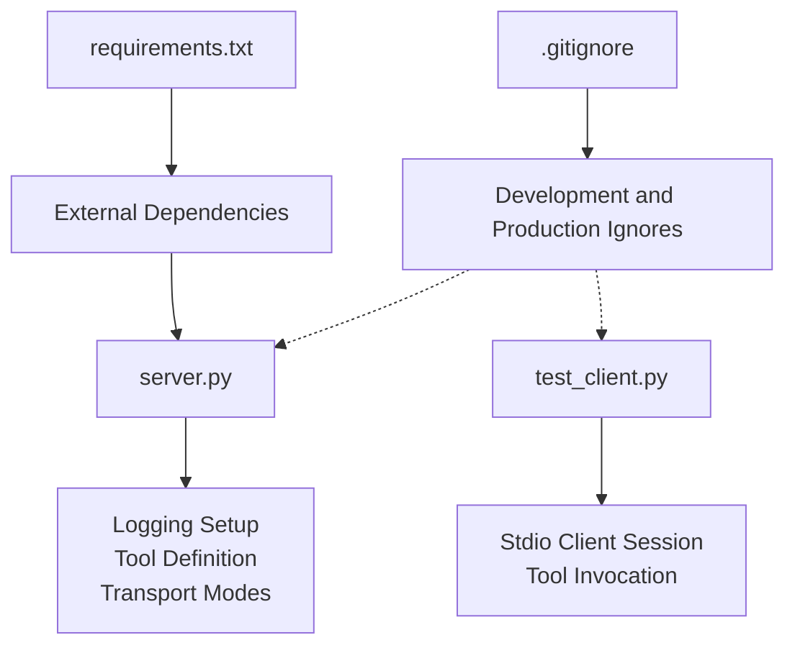
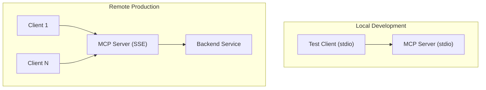
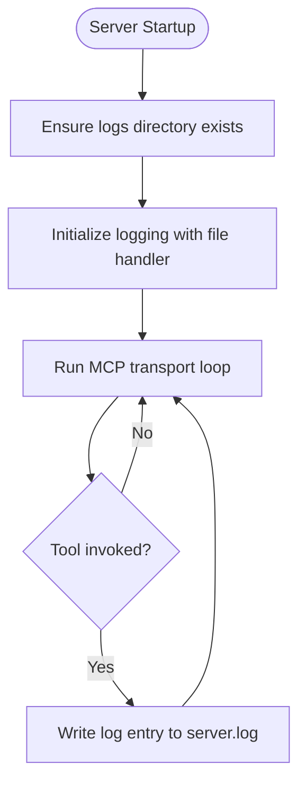
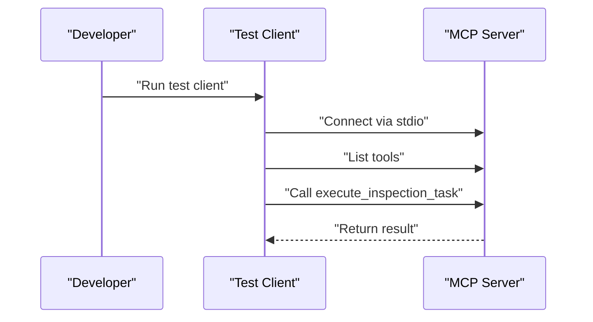
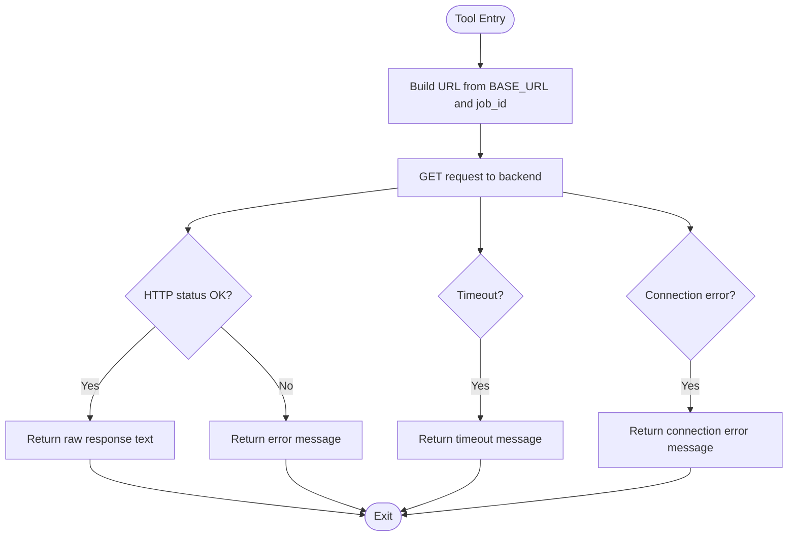
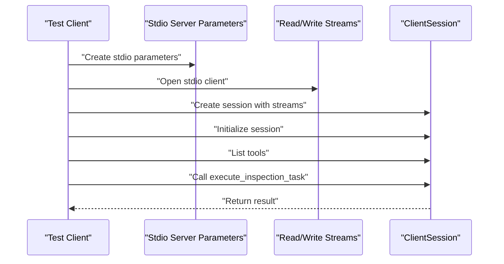
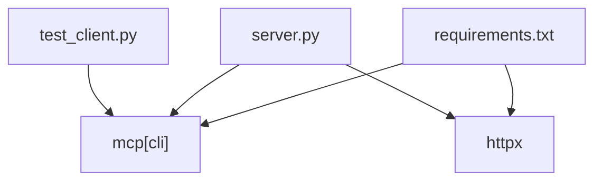

# Configuration and Deployment

<cite>
**Referenced Files in This Document**
- [.gitignore](file://.gitignore)
- [requirements.txt](file://requirements.txt)
- [server.py](file://server.py)
- [test_client.py](file://test_client.py)
</cite>

## Table of Contents
1. [Introduction](#introduction)
2. [Project Structure](#project-structure)
3. [Core Components](#core-components)
4. [Architecture Overview](#architecture-overview)
5. [Detailed Component Analysis](#detailed-component-analysis)
6. [Dependency Analysis](#dependency-analysis)
7. [Performance Considerations](#performance-considerations)
8. [Troubleshooting Guide](#troubleshooting-guide)
9. [Conclusion](#conclusion)
10. [Appendices](#appendices)

## Introduction
This document provides configuration and deployment guidance for MCP Execution Fly. It covers environment setup, logging configuration with automatic log directory creation, transport mode selection between stdio and SSE, .gitignore patterns for development and production workflows, configuration options such as BASE_URL and logging levels, performance tuning, deployment topologies for local development and remote production, security considerations, monitoring setup, and maintenance procedures.

## Project Structure
The repository contains a minimal yet complete setup for an MCP server that exposes a single tool to trigger inspection tasks against a backend service. Key files include:
- A server implementation that initializes logging, defines a tool, and starts the MCP runtime in either stdio or SSE transport modes.
- A client script that connects to the server via stdio and exercises the tool.
- A requirements file declaring external dependencies.
- A .gitignore file controlling which artifacts are excluded from version control.

**Diagram sources**
- [.gitignore:1-54](file://.gitignore#L1-L54)
- [requirements.txt:1-2](file://requirements.txt#L1-L2)
- [server.py:1-90](file://server.py#L1-L90)
- [test_client.py:1-45](file://test_client.py#L1-L45)

**Section sources**
- [.gitignore:1-54](file://.gitignore#L1-L54)
- [requirements.txt:1-2](file://requirements.txt#L1-L2)
- [server.py:1-90](file://server.py#L1-L90)
- [test_client.py:1-45](file://test_client.py#L1-L45)

## Core Components
- Logging subsystem: Automatically creates a logs directory and writes server logs to a file with a consistent format and level.
- MCP server instance: Exposes a tool named for executing inspection tasks and forwards requests to a configurable backend endpoint.
- Transport modes: Supports stdio for local development and SSE for remote deployments.
- Client session: Demonstrates connecting to the server via stdio and invoking the tool.

Key configuration touchpoints:
- BASE_URL: Backend endpoint for inspection task execution.
- Logging level: Configured to DEBUG by default.
- Transport selection: Controlled by the mcp.run call’s transport parameter.

**Section sources**
- [server.py:8-21](file://server.py#L8-L21)
- [server.py:26-30](file://server.py#L26-L30)
- [server.py:35-76](file://server.py#L35-L76)
- [server.py:81-90](file://server.py#L81-L90)
- [test_client.py:13-45](file://test_client.py#L13-L45)

## Architecture Overview
The system architecture centers on an MCP server that acts as a bridge between an LLM client and a backend service. The server runs in two primary modes:
- stdio: Local development and testing with a single client connection.
- SSE: Remote deployment enabling multiple concurrent clients.

**Diagram sources**
- [server.py:86-90](file://server.py#L86-L90)
- [test_client.py:13-45](file://test_client.py#L13-L45)

## Detailed Component Analysis

### Logging Configuration and Automatic Log Directory Creation
- Log directory: Created automatically under the server’s directory as logs/.
- Log file: server.log is written with UTF-8 encoding.
- Log format: Timestamped entries with severity and message.
- Log level: Set to DEBUG by default.

Operational behavior:
- On startup, the server ensures the logs directory exists and initializes logging accordingly.
- All tool invocations and errors are logged to the file.

**Diagram sources**
- [server.py:11-21](file://server.py#L11-L21)
- [server.py:51-75](file://server.py#L51-L75)

**Section sources**
- [server.py:11-21](file://server.py#L11-L21)
- [server.py:51-75](file://server.py#L51-L75)

### Transport Mode Selection: stdio vs SSE
- stdio mode:
  - Purpose: Local development and testing with a single client.
  - Activation: mcp.run(transport="stdio").
  - Typical usage: Running the test client locally to connect to the server process.
- SSE mode:
  - Purpose: Remote deployment supporting multiple concurrent clients.
  - Activation: mcp.run(transport="sse", host="0.0.0.0", port=9000).
  - Notes: The host and port are configurable; ensure network exposure aligns with security policies.

**Diagram sources**
- [test_client.py:13-45](file://test_client.py#L13-L45)
- [server.py:86-87](file://server.py#L86-L87)

**Section sources**
- [server.py:86-90](file://server.py#L86-L90)
- [test_client.py:13-45](file://test_client.py#L13-L45)

### Tool Definition and Backend Integration
- Tool name: execute_inspection_task.
- Behavior: Builds a URL from BASE_URL and job_id, performs an asynchronous GET request, logs the response, and returns the raw response text.
- Error handling: Catches connection errors, timeouts, and general exceptions, returning user-friendly messages and logging details.

**Diagram sources**
- [server.py:35-76](file://server.py#L35-L76)

**Section sources**
- [server.py:28-30](file://server.py#L28-L30)
- [server.py:35-76](file://server.py#L35-L76)

### Client Interaction Pattern
- The test client establishes a stdio connection to the server, initializes a session, lists tools, and invokes the inspection task with a job identifier.
- This demonstrates the stdio transport flow and validates tool availability and invocation.

**Diagram sources**
- [test_client.py:13-45](file://test_client.py#L13-L45)

**Section sources**
- [test_client.py:13-45](file://test_client.py#L13-L45)

## Dependency Analysis
External dependencies:
- mcp[cli]: Provides the MCP server framework and client abstractions.
- httpx: Enables asynchronous HTTP requests to the backend service.

Internal relationships:
- server.py depends on logging and httpx for runtime behavior.
- test_client.py depends on mcp client abstractions to communicate with the server.

**Diagram sources**
- [requirements.txt:1-2](file://requirements.txt#L1-L2)
- [server.py:4-6](file://server.py#L4-L6)
- [test_client.py:2-4](file://test_client.py#L2-L4)

**Section sources**
- [requirements.txt:1-2](file://requirements.txt#L1-L2)
- [server.py:4-6](file://server.py#L4-L6)
- [test_client.py:2-4](file://test_client.py#L2-L4)

## Performance Considerations
- Logging level: Currently set to DEBUG. For production, consider switching to INFO or WARNING to reduce I/O overhead and log volume.
- Timeout: The backend request timeout is set to 30 seconds. Adjust based on expected backend latency and SLAs.
- Concurrency: SSE mode supports multiple clients. Ensure the backend service can handle concurrent load and consider rate limiting or queuing if needed.
- Resource usage: Monitor CPU and memory usage during peak loads; scale horizontally if necessary.

[No sources needed since this section provides general guidance]

## Troubleshooting Guide
Common issues and resolutions:
- Backend connectivity failures:
  - Symptom: Returned message indicating inability to connect to the backend.
  - Action: Verify BASE_URL correctness and backend service availability.
- Timeouts:
  - Symptom: Returned message indicating the backend did not respond within the configured timeout.
  - Action: Increase timeout or investigate backend responsiveness.
- Logging:
  - Location: logs/server.log under the server directory.
  - Level: DEBUG by default; adjust for production environments.
- Transport mode mismatch:
  - Symptom: Client cannot connect.
  - Action: Ensure the server is started in the same transport mode as the client expects (stdio for local testing).

**Section sources**
- [server.py:67-75](file://server.py#L67-L75)
- [server.py:81-84](file://server.py#L81-L84)

## Conclusion
MCP Execution Fly provides a straightforward configuration model with clear transport options for local and remote deployments. By adjusting logging levels, configuring BASE_URL, and selecting the appropriate transport mode, teams can tailor the system for development, staging, and production environments while maintaining robust error handling and observability.

[No sources needed since this section summarizes without analyzing specific files]

## Appendices

### Environment Setup Requirements
- Python interpreter and virtual environment.
- Install dependencies declared in requirements.txt.
- Ensure the backend service referenced by BASE_URL is reachable from the server host.

**Section sources**
- [requirements.txt:1-2](file://requirements.txt#L1-L2)
- [server.py:28-30](file://server.py#L28-L30)

### Logging Configuration Details
- Automatic log directory creation: logs/ is created if missing.
- Log file: server.log with UTF-8 encoding.
- Log format: Timestamped entries with severity and message.
- Log level: DEBUG by default; suitable for development; consider raising in production.

**Section sources**
- [server.py:11-21](file://server.py#L11-L21)

### Transport Mode Selection
- stdio:
  - Use for local development and testing with a single client.
  - Start with mcp.run(transport="stdio").
- SSE:
  - Use for remote deployments supporting multiple clients.
  - Start with mcp.run(transport="sse", host="0.0.0.0", port=9000).

**Section sources**
- [server.py:86-90](file://server.py#L86-L90)

### .gitignore Patterns
- Python bytecode and caches.
- Virtual environments.
- IDE-specific files.
- Logs and log files.
- Environment variable files.

These patterns help keep repositories clean and secure by excluding transient and sensitive artifacts.

**Section sources**
- [.gitignore:1-54](file://.gitignore#L1-L54)

### Configuration Options
- BASE_URL: Modify the backend endpoint used by the tool.
- Logging level: Adjust the logging level in the logging configuration.
- Transport: Choose between stdio and SSE depending on deployment topology.

**Section sources**
- [server.py:28-30](file://server.py#L28-L30)
- [server.py:14-21](file://server.py#L14-L21)
- [server.py:86-90](file://server.py#L86-L90)

### Deployment Topologies
- Local development with stdio:
  - Run the test client to connect to the server via stdio.
  - Ideal for interactive development and quick iteration.
- Remote production with SSE:
  - Start the server in SSE mode to accept connections from multiple clients.
  - Configure host and port according to infrastructure requirements.

**Section sources**
- [test_client.py:13-45](file://test_client.py#L13-L45)
- [server.py:86-90](file://server.py#L86-L90)

### Security Considerations
- Network exposure: When using SSE, bind to trusted interfaces and restrict access via firewalls or reverse proxies.
- Secrets management: Avoid embedding credentials in BASE_URL; prefer environment variables or secret stores.
- Logging sensitivity: Review logs for sensitive data; consider redaction and retention policies.

[No sources needed since this section provides general guidance]

### Monitoring Setup
- Application metrics: Track request rates, latency, and error rates for the tool.
- Health checks: Expose a health endpoint to monitor server readiness.
- Observability: Integrate structured logging with centralized log aggregation and alerting.

[No sources needed since this section provides general guidance]

### Maintenance Procedures
- Regular log rotation: Rotate logs to prevent disk growth.
- Dependency updates: Periodically review and update dependencies per security advisories.
- Backup and recovery: Back up configuration and logs; test restoration procedures.

[No sources needed since this section provides general guidance]