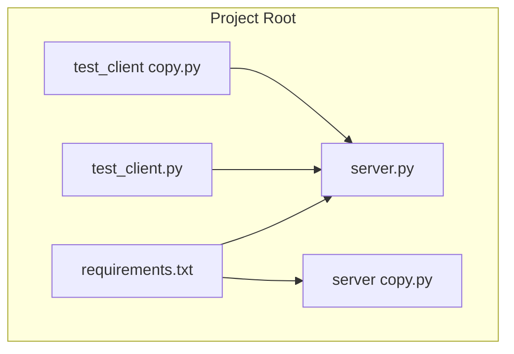
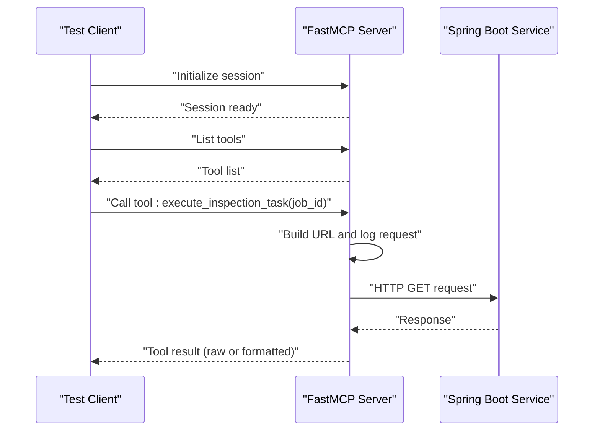
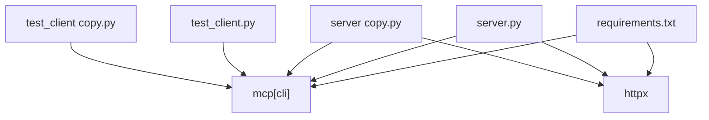

# Core Components

<cite>
**Referenced Files in This Document**
- [server.py](file://server.py)
- [server copy.py](file://server copy.py)
- [test_client.py](file://test_client.py)
- [test_client copy.py](file://test_client copy.py)
- [requirements.txt](file://requirements.txt)
</cite>

## Table of Contents
1. [Introduction](#introduction)
2. [Project Structure](#project-structure)
3. [Core Components](#core-components)
4. [Architecture Overview](#architecture-overview)
5. [Detailed Component Analysis](#detailed-component-analysis)
6. [Dependency Analysis](#dependency-analysis)
7. [Performance Considerations](#performance-considerations)
8. [Troubleshooting Guide](#troubleshooting-guide)
9. [Conclusion](#conclusion)

## Introduction
This document provides a comprehensive analysis of the core components in the MCP Execution Fly project. It focuses on the main server implementation in server.py, the alternative server variant in server copy.py, and the test clients in test_client.py and test_client copy.py. The goal is to explain the FastMCP server instantiation, tool definition with execute_inspection_task, HTTP client integration, and the differences between the two server implementations. It also documents the test clients' capabilities, logging configurations, and usage patterns, along with the relationships among components in the overall system architecture.

## Project Structure
The project consists of four primary Python scripts and a requirements file:
- server.py: Main server implementation with logging, FastMCP instantiation, tool definition, and HTTP client integration.
- server copy.py: Alternative server implementation with simplified logging and explicit success/failure handling.
- test_client.py: Comprehensive test client with detailed logging and structured tool invocation.
- test_client copy.py: Minimal test client demonstrating basic tool listing and invocation.
- requirements.txt: Declares the MCP CLI library and HTTP client dependency.

**Diagram sources**
- [requirements.txt:1-2](file://requirements.txt#L1-L2)
- [server.py:1-90](file://server.py#L1-L90)
- [server copy.py:1-74](file://server copy.py#L1-L74)
- [test_client.py:1-45](file://test_client.py#L1-L45)
- [test_client copy.py:1-31](file://test_client copy.py#L1-L31)

**Section sources**
- [requirements.txt:1-2](file://requirements.txt#L1-L2)
- [server.py:1-90](file://server.py#L1-L90)
- [server copy.py:1-74](file://server copy.py#L1-L74)
- [test_client.py:1-45](file://test_client.py#L1-L45)
- [test_client copy.py:1-31](file://test_client copy.py#L1-L31)

## Core Components
This section outlines the primary building blocks of the system and their responsibilities:
- FastMCP Server Instance: Creates the MCP server runtime with a unique server name and exposes tools to clients.
- Tool Definition: Defines the execute_inspection_task tool with a clear description and argument contract.
- HTTP Client Integration: Performs asynchronous HTTP requests to a Spring Boot service endpoint and returns raw or formatted responses.
- Test Clients: Demonstrate connecting to the server via stdio transport, listing tools, and invoking the inspection task with structured logging or minimal output.

Key implementation patterns:
- Logging: server.py configures file-based logging with timestamps and levels; server copy.py uses stderr prints for debugging.
- Transport Modes: Both servers support stdio mode for local development and can be adapted for SSE mode for remote deployments.
- Error Handling: server.py centralizes exceptions into user-friendly messages; server copy.py checks HTTP status codes and returns structured success/failure messages.

**Section sources**
- [server.py:26](file://server.py#L26)
- [server.py:35-76](file://server.py#L35-L76)
- [server copy.py:9-61](file://server copy.py#L9-L61)
- [test_client.py:13-44](file://test_client.py#L13-L44)
- [test_client copy.py:6-30](file://test_client copy.py#L6-L30)

## Architecture Overview
The system follows a client-server architecture using the MCP protocol over stdio transport. The test client connects to the server, initializes a session, lists available tools, and invokes the inspection task. The server executes the tool, forwards the request to a Spring Boot backend, and returns the result to the client.

**Diagram sources**
- [test_client.py:24-42](file://test_client.py#L24-L42)
- [server.py:35-76](file://server.py#L35-L76)
- [server copy.py:20-61](file://server copy.py#L20-L61)

## Detailed Component Analysis

### FastMCP Server (server.py)
Responsibilities:
- Configures logging to a dedicated log file under a logs directory.
- Instantiates a FastMCP server with a descriptive server name.
- Exposes the execute_inspection_task tool with a natural-language description and argument contract.
- Integrates an HTTP client to communicate with a Spring Boot service endpoint.
- Handles connection errors, timeouts, and unexpected exceptions with user-friendly messages.
- Supports stdio and SSE transports; stdio is enabled by default.

Key implementation details:
- Logging setup creates a logs directory and writes formatted entries to server.log.
- Tool function signature accepts a job_id argument and returns a string result.
- HTTP client uses an async context manager with a 30-second timeout.
- Error handling branches cover connection failures, timeouts, and general exceptions.

Usage patterns:
- Local development via stdio transport with a client process.
- Remote deployment via SSE transport by uncommenting the SSE configuration.

**Section sources**
- [server.py:14-21](file://server.py#L14-L21)
- [server.py:26](file://server.py#L26)
- [server.py:35-76](file://server.py#L35-L76)
- [server.py:81-90](file://server.py#L81-L90)

### Alternative Server Implementation (server copy.py)
Responsibilities:
- Minimal logging using stderr prints for debug visibility.
- Same tool definition with identical description and argument contract.
- Explicit success/failure handling based on HTTP status codes.
- Simplified return messages indicating whether the task was successfully dispatched.

Key implementation details:
- Uses print statements to stderr for debugging output.
- Parses JSON response when successful and constructs a human-readable message.
- Returns structured messages for non-200 responses and exceptions.

Usage patterns:
- Quick testing and debugging scenarios where verbose logging is unnecessary.
- Demonstrates a different approach to result formatting compared to server.py.

**Section sources**
- [server copy.py:36-61](file://server copy.py#L36-L61)
- [server copy.py:20-61](file://server copy.py#L20-L61)

### Test Client (test_client.py)
Responsibilities:
- Establishes a stdio connection to the server process.
- Initializes an MCP session and lists available tools.
- Invokes the execute_inspection_task tool with a predefined job_id.
- Logs detailed information about each step and prints the resulting content.

Key implementation details:
- Uses StdioServerParameters to spawn the server process and connect via stdio.
- Wraps the stdio stream pair with ClientSession for MCP communication.
- Lists tools and iterates through tool metadata for display.
- Calls the tool with arguments and logs the returned content.

Usage patterns:
- Ideal for end-to-end testing with comprehensive logging.
- Demonstrates structured logging and result extraction from the tool response.

**Section sources**
- [test_client.py:16-26](file://test_client.py#L16-L26)
- [test_client.py:28-42](file://test_client.py#L28-L42)

### Minimal Test Client (test_client copy.py)
Responsibilities:
- Establishes a stdio connection to the server process.
- Initializes an MCP session and lists available tools.
- Invokes the execute_inspection_task tool with a predefined job_id.
- Prints the resulting content without extensive logging.

Key implementation details:
- Uses the same stdio client and session initialization as the comprehensive test client.
- Focuses on essential steps: listing tools and invoking the inspection task.

Usage patterns:
- Lightweight testing scenarios where minimal output suffices.
- Good starting point for new developers to understand the basic workflow.

**Section sources**
- [test_client copy.py:7-14](file://test_client copy.py#L7-L14)
- [test_client copy.py:16-28](file://test_client copy.py#L16-L28)

### Tool Definition: execute_inspection_task
Both server implementations define the same tool with a consistent description and argument contract:
- Tool name: execute_inspection_task
- Argument: job_id (string)
- Purpose: Trigger a flight inspection task by calling a Spring Boot endpoint with the job_id as a path parameter.
- Behavior: Builds a URL from a base endpoint and the job_id, performs an HTTP GET request, and returns either the raw response or a formatted success/failure message.

Comparison highlights:
- server.py returns the raw response text and logs detailed information.
- server copy.py parses JSON on success and returns a structured message; it also checks HTTP status codes explicitly.

**Section sources**
- [server.py:35-76](file://server.py#L35-L76)
- [server copy.py:20-61](file://server copy.py#L20-L61)

## Dependency Analysis
External dependencies:
- mcp[cli]: Provides the FastMCP server framework and client session abstractions used by both servers and test clients.
- httpx: Enables asynchronous HTTP client operations for interacting with the Spring Boot service.

Internal relationships:
- server.py depends on FastMCP and httpx to expose the tool and perform HTTP requests.
- server copy.py mirrors the same dependencies with a simpler logging approach.
- test_client.py and test_client copy.py depend on the MCP client libraries to establish stdio connections and manage sessions.

**Diagram sources**
- [requirements.txt:1-2](file://requirements.txt#L1-L2)
- [server.py:6](file://server.py#L6)
- [server copy.py:4](file://server copy.py#L4)
- [test_client.py:3](file://test_client.py#L3)
- [test_client copy.py:3](file://test_client copy.py#L3)

**Section sources**
- [requirements.txt:1-2](file://requirements.txt#L1-L2)
- [server.py:6](file://server.py#L6)
- [server copy.py:4](file://server copy.py#L4)
- [test_client.py:3](file://test_client.py#L3)
- [test_client copy.py:3](file://test_client copy.py#L3)

## Performance Considerations
- Asynchronous HTTP client: Both server implementations use an async HTTP client, which improves responsiveness during network-bound operations.
- Timeout configuration: The HTTP client uses a 30-second timeout, balancing reliability against resource consumption.
- Logging overhead: server.py writes to a file, which may introduce I/O overhead; server copy.py uses stderr prints, which are generally lighter but less structured.
- Transport choice: stdio transport is suitable for local development; SSE transport enables multi-client access but requires additional infrastructure.

[No sources needed since this section provides general guidance]

## Troubleshooting Guide
Common issues and resolutions:
- Connection failures: server.py catches connection errors and returns a user-friendly message suggesting the backend service may be down. Verify the BASE_URL and service availability.
- Request timeouts: server.py handles timeout exceptions and informs the user that the backend did not respond within the configured timeout window.
- Unexpected exceptions: server.py logs detailed exception information and returns a generic error message; review the server logs for stack traces.
- Status code mismatches: server copy.py explicitly checks HTTP status codes and returns structured messages for non-200 responses; confirm the backend endpoint behavior and payload format.
- Logging visibility: server.py writes to logs/server.log; ensure the logs directory exists and is writable. server copy.py prints debug messages to stderr; verify stderr redirection if needed.

**Section sources**
- [server.py:67-75](file://server.py#L67-L75)
- [server copy.py:54-60](file://server copy.py#L54-L60)

## Conclusion
The MCP Execution Fly project demonstrates a clean separation of concerns between the server and client components. The main server implementation in server.py emphasizes robust logging and flexible error handling, while the alternative server in server copy.py prioritizes simplicity and explicit success/failure messaging. The test clients showcase practical usage patterns for connecting to the server, listing tools, and invoking the inspection task. Together, these components form a cohesive system for orchestrating flight inspection tasks through an MCP-enabled workflow.