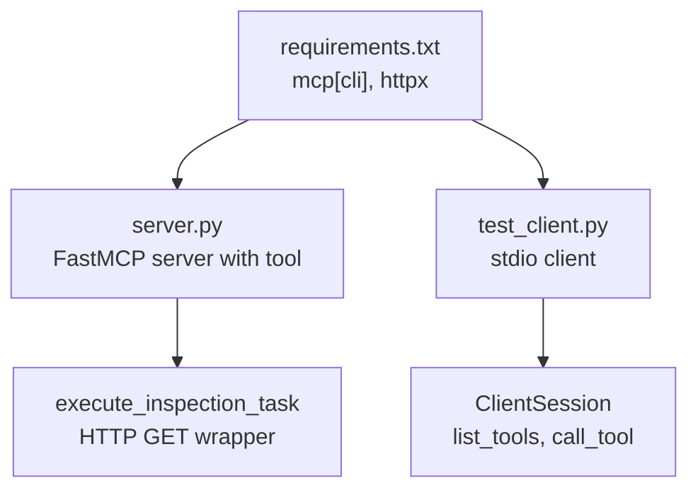
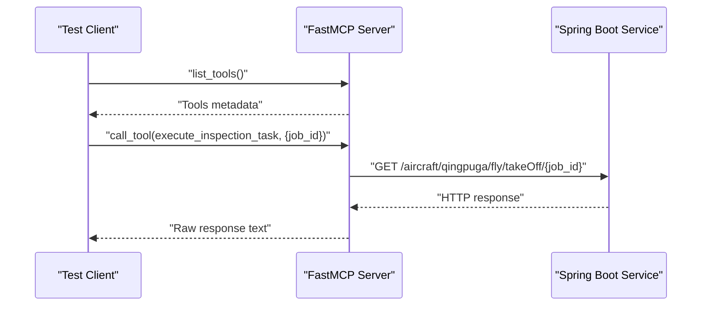
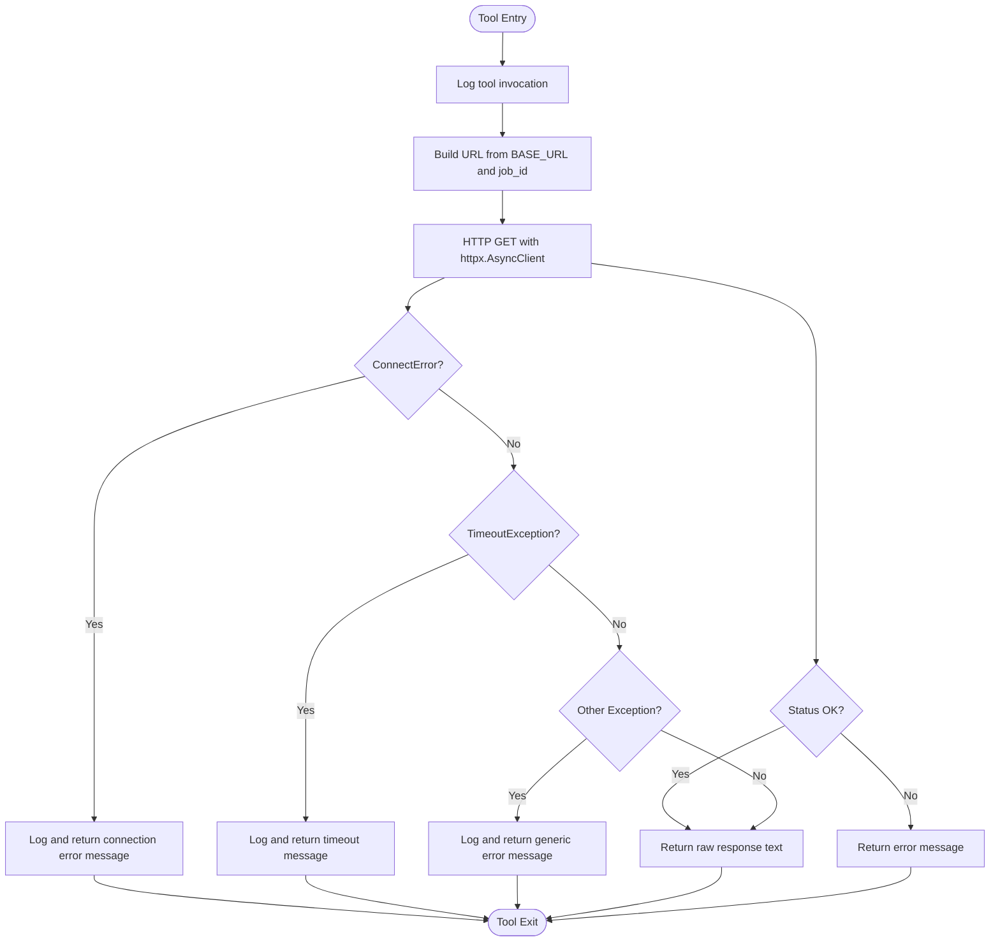
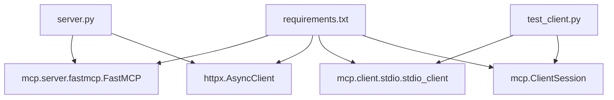

# Development Guide

<cite>
**Referenced Files in This Document**
- [server.py](file://server.py)
- [server copy.py](file://server copy.py)
- [test_client.py](file://test_client.py)
- [test_client copy.py](file://test_client copy.py)
- [requirements.txt](file://requirements.txt)
</cite>

## Table of Contents
1. [Introduction](#introduction)
2. [Project Structure](#project-structure)
3. [Core Components](#core-components)
4. [Architecture Overview](#architecture-overview)
5. [Detailed Component Analysis](#detailed-component-analysis)
6. [Dependency Analysis](#dependency-analysis)
7. [Performance Considerations](#performance-considerations)
8. [Troubleshooting Guide](#troubleshooting-guide)
9. [Conclusion](#conclusion)
10. [Appendices](#appendices)

## Introduction
This development guide explains how to extend MCP Execution Fly, focusing on:
- Adding new tools via @mcp.tool() decorators
- Customizing error handling mechanisms
- Extending beyond the execute_inspection_task tool
- Factory pattern for FastMCP server instantiation
- Logging system customization
- Transport abstraction patterns (stdio vs SSE)
- Practical examples: adding new flight inspection task types, modifying HTTP client behavior, and implementing custom response processing
- Code organization principles, testing strategies, and best practices for MCP protocol compliance

## Project Structure
The repository contains minimal, focused modules that demonstrate a complete MCP server implementation with a single tool and a simple client for testing.

**Diagram sources**
- [server.py:26-76](file://server.py#L26-L76)
- [test_client.py:16-42](file://test_client.py#L16-L42)
- [requirements.txt:1-2](file://requirements.txt#L1-L2)

**Section sources**
- [server.py:1-90](file://server.py#L1-L90)
- [test_client.py:1-45](file://test_client.py#L1-L45)
- [requirements.txt:1-2](file://requirements.txt#L1-L2)

## Core Components
- FastMCP server factory: Creates an MCP server instance with a given name and registers tools via decorators.
- Tool function: A single async tool that forwards user requests to a backend service and returns the raw response.
- HTTP client: Uses httpx.AsyncClient with a fixed timeout to communicate with the backend.
- Logging: Configured to write to a local log file under a logs directory.
- Transport: Supports stdio and SSE transports; stdio is enabled by default.

Key implementation references:
- FastMCP instantiation and tool registration: [server.py:26](file://server.py#L26), [server.py:35](file://server.py#L35)
- Tool function and HTTP call: [server.py:35-76](file://server.py#L35-L76)
- Logging configuration: [server.py:14-21](file://server.py#L14-L21)
- Transport selection: [server.py:86-90](file://server.py#L86-L90)
- Client usage of list_tools and call_tool: [test_client.py:28-42](file://test_client.py#L28-L42)

**Section sources**
- [server.py:26-76](file://server.py#L26-L76)
- [server.py:14-21](file://server.py#L14-L21)
- [server.py:86-90](file://server.py#L86-L90)
- [test_client.py:28-42](file://test_client.py#L28-L42)

## Architecture Overview
The system follows a simple MCP server architecture:
- A FastMCP server exposes tools to clients.
- Clients connect via stdio or SSE and can list tools and invoke them.
- Tools forward requests to a backend service and return the response.

**Diagram sources**
- [server.py:35-76](file://server.py#L35-L76)
- [test_client.py:28-42](file://test_client.py#L28-L42)

## Detailed Component Analysis

### FastMCP Server Factory Pattern
- The server creates a FastMCP instance with a descriptive name.
- Tools are registered using the @mcp.tool() decorator on async functions.
- The server can be started with different transports (stdio or SSE).

Implementation highlights:
- Server creation: [server.py:26](file://server.py#L26)
- Tool registration: [server.py:35](file://server.py#L35)
- Transport selection: [server.py:86-90](file://server.py#L86-L90)

Best practices:
- Keep the server name meaningful for discovery.
- Use async tool functions to avoid blocking the event loop.
- Expose only necessary tools; keep descriptions clear and actionable.

**Section sources**
- [server.py:26](file://server.py#L26)
- [server.py:35](file://server.py#L35)
- [server.py:86-90](file://server.py#L86-L90)

### Tool Function: execute_inspection_task
- Purpose: Accepts a job identifier and forwards it to the backend service.
- Behavior: Builds a URL from a base URL and job ID, performs an HTTP GET, logs the request and response, and returns the raw response text.
- Error handling: Catches connection errors, timeouts, and general exceptions, returning user-friendly messages.

**Diagram sources**
- [server.py:35-76](file://server.py#L35-L76)

**Section sources**
- [server.py:35-76](file://server.py#L35-L76)

### Logging System Customization
- Logs are written to a dedicated file under a logs directory.
- The logger name is set to a specific identifier for MCP server logs.
- Logging format includes timestamps, severity, and message.

Customization tips:
- Adjust log level for production environments.
- Add structured logging for better observability.
- Consider rotating log files for long-running deployments.

**Section sources**
- [server.py:14-21](file://server.py#L14-L21)

### Transport Abstraction Patterns
- stdio transport: Suitable for local development and desktop integrations.
- SSE transport: Enables remote deployment and multiple concurrent clients.

Usage:
- Enable stdio by default: [server.py:86](file://server.py#L86)
- Enable SSE for remote deployments: [server.py:89](file://server.py#L89)

**Section sources**
- [server.py:86-90](file://server.py#L86-L90)

### HTTP Client Behavior and Response Processing
- The tool uses httpx.AsyncClient with a fixed timeout.
- The tool returns the raw response text without parsing or validation.
- Alternative implementation in the copied server demonstrates JSON parsing and conditional success/error messaging.

Practical modifications:
- Increase or decrease timeout based on backend latency.
- Parse JSON responses and validate status codes.
- Implement retry logic for transient failures.

**Section sources**
- [server.py:57-65](file://server.py#L57-L65)
- [server copy.py:43-60](file://server copy.py#L43-L60)

### Adding New Tools
Steps to add a new tool:
1. Define a new async function decorated with @mcp.tool().
2. Provide a clear docstring describing when and how the tool should be used.
3. Implement the tool’s logic, including HTTP calls and error handling.
4. Register the tool by importing the module or ensuring it is executed during server startup.

Example references:
- Tool definition pattern: [server.py:35](file://server.py#L35)
- Tool function body: [server.py:35-76](file://server.py#L35-L76)

**Section sources**
- [server.py:35](file://server.py#L35)
- [server.py:35-76](file://server.py#L35-L76)

### Extending Beyond execute_inspection_task
To support additional flight inspection tasks:
- Add new tool functions for distinct tasks (e.g., “land”, “hover”, “inspect_engine”).
- Each tool should accept relevant parameters and forward them to the appropriate backend endpoint.
- Keep tool descriptions precise so the LLM selects the correct action.

References:
- Tool registration: [server.py:35](file://server.py#L35)
- Tool invocation from client: [test_client.py:37-42](file://test_client.py#L37-L42)

**Section sources**
- [server.py:35](file://server.py#L35)
- [test_client.py:37-42](file://test_client.py#L37-L42)

### Testing Strategies for New Components
Recommended testing approaches:
- Unit tests for tool logic: Mock httpx.AsyncClient to simulate backend responses and errors.
- Integration tests: Use the existing stdio client to verify tool discovery and invocation.
- Protocol compliance tests: Ensure tools return text content and handle errors gracefully.

References:
- Client tool listing and invocation: [test_client.py:28-42](file://test_client.py#L28-L42)

**Section sources**
- [test_client.py:28-42](file://test_client.py#L28-L42)

## Dependency Analysis
External dependencies:
- mcp[cli]: Provides the FastMCP server framework and client abstractions.
- httpx: Asynchronous HTTP client used by tools to call backend services.

**Diagram sources**
- [server.py:6](file://server.py#L6)
- [server.py:5](file://server.py#L5)
- [test_client.py:3](file://test_client.py#L3)
- [requirements.txt:1-2](file://requirements.txt#L1-L2)

**Section sources**
- [requirements.txt:1-2](file://requirements.txt#L1-L2)
- [server.py:6](file://server.py#L6)
- [server.py:5](file://server.py#L5)
- [test_client.py:3](file://test_client.py#L3)

## Performance Considerations
- Use async tool functions to prevent blocking the server event loop.
- Configure appropriate timeouts for backend calls to avoid hanging requests.
- Consider connection pooling and retries for high-throughput scenarios.
- Monitor log volume and adjust log levels for production environments.

## Troubleshooting Guide
Common issues and resolutions:
- Connection failures: Verify backend service availability and network connectivity.
- Timeouts: Increase the httpx client timeout or optimize backend response times.
- Tool not discovered: Ensure the tool function is defined and imported before server startup.
- Transport mismatch: Confirm client and server use compatible transports (stdio vs SSE).

References:
- Error handling in tool: [server.py:67-75](file://server.py#L67-L75)
- Transport selection: [server.py:86-90](file://server.py#L86-L90)

**Section sources**
- [server.py:67-75](file://server.py#L67-L75)
- [server.py:86-90](file://server.py#L86-L90)

## Conclusion
MCP Execution Fly provides a concise foundation for building MCP servers. By leveraging the FastMCP factory pattern, decorators, and transport abstractions, you can easily add new tools, customize error handling, and extend functionality while maintaining MCP protocol compliance. Use the provided patterns and testing strategies to ensure robust, maintainable extensions.

## Appendices

### Practical Example: Adding a New Flight Inspection Task Type
Steps:
1. Define a new async tool function with a descriptive docstring.
2. Implement HTTP forwarding to the appropriate backend endpoint.
3. Add error handling and logging.
4. Test with the stdio client to verify discovery and invocation.

References:
- Tool definition pattern: [server.py:35](file://server.py#L35)
- Tool invocation: [test_client.py:37-42](file://test_client.py#L37-L42)

**Section sources**
- [server.py:35](file://server.py#L35)
- [test_client.py:37-42](file://test_client.py#L37-L42)

### Practical Example: Modifying HTTP Client Behavior
Options:
- Change timeout values for different task types.
- Introduce retry logic for transient failures.
- Switch from raw text to parsed JSON responses.

References:
- HTTP client usage: [server.py:57-65](file://server.py#L57-L65)
- Alternative parsing behavior: [server copy.py:43-60](file://server copy.py#L43-L60)

**Section sources**
- [server.py:57-65](file://server.py#L57-L65)
- [server copy.py:43-60](file://server copy.py#L43-L60)

### Practical Example: Implementing Custom Response Processing
Approach:
- Parse backend responses and extract meaningful fields.
- Validate status codes and return structured messages.
- Log parsed results for observability.

References:
- Raw response return: [server.py:65](file://server.py#L65)
- Parsed response handling: [server copy.py:47-52](file://server copy.py#L47-L52)

**Section sources**
- [server.py:65](file://server.py#L65)
- [server copy.py:47-52](file://server copy.py#L47-L52)