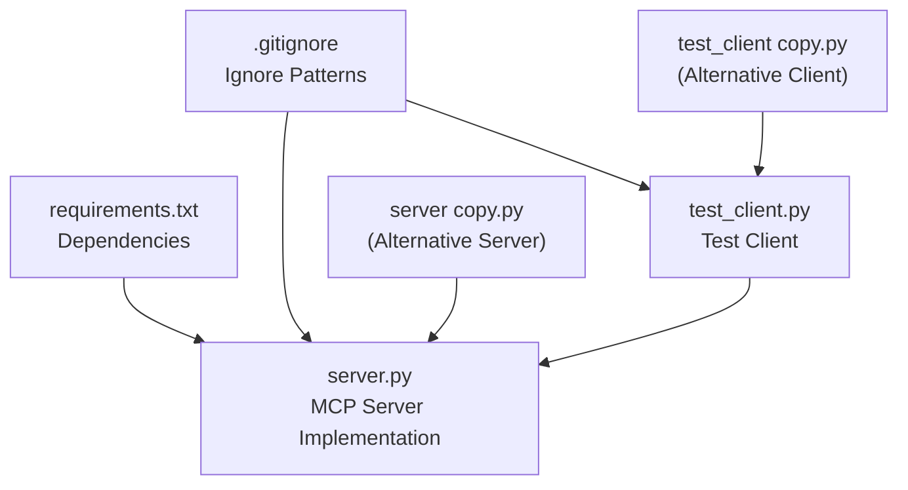
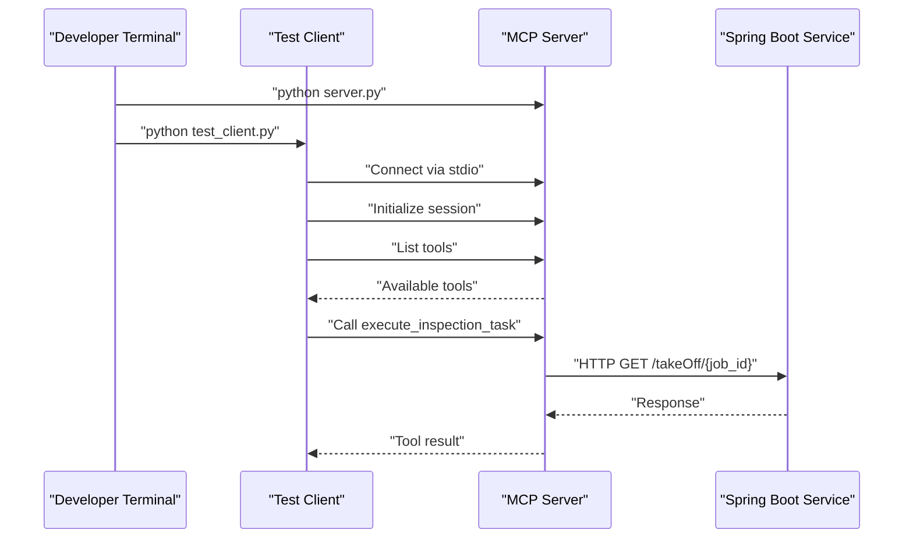

# Getting Started

<cite>
**Referenced Files in This Document**
- [requirements.txt](file://requirements.txt)
- [server.py](file://server.py)
- [test_client.py](file://test_client.py)
- [.gitignore](file://.gitignore)
</cite>

## Table of Contents
1. [Introduction](#introduction)
2. [Project Structure](#project-structure)
3. [Installation Requirements](#installation-requirements)
4. [Basic Setup](#basic-setup)
5. [First Run Examples](#first-run-examples)
6. [Transport Modes](#transport-modes)
7. [Verification Steps](#verification-steps)
8. [Troubleshooting Guide](#troubleshooting-guide)
9. [Next Steps](#next-steps)

## Introduction
MCP Execution Fly is a minimal MCP (Model Context Protocol) server designed to execute flight inspection tasks by delegating to a backend Spring Boot service. It demonstrates two transport modes:
- stdio transport for local development and testing
- SSE transport for remote deployment scenarios

The server exposes a single tool called execute_inspection_task, which accepts a job_id argument and forwards requests to a configurable backend endpoint.

## Project Structure
The repository contains a focused set of files that implement the MCP server and a simple test client:



**Diagram sources**
- [requirements.txt:1-2](file://requirements.txt#L1-L2)
- [server.py:1-90](file://server.py#L1-L90)
- [test_client.py:1-45](file://test_client.py#L1-L45)
- [.gitignore:1-54](file://.gitignore#L1-L54)

**Section sources**
- [requirements.txt:1-2](file://requirements.txt#L1-L2)
- [server.py:1-90](file://server.py#L1-L90)
- [test_client.py:1-45](file://test_client.py#L1-L45)
- [.gitignore:1-54](file://.gitignore#L1-L54)

## Installation Requirements
MCP Execution Fly requires Python 3.x and specific dependencies managed via pip. The project declares its dependencies in requirements.txt.

### Python Version
- Requires Python 3.x (recommended: Python 3.8+)
- Tested with modern Python versions compatible with the MCP ecosystem

### Dependencies
The project depends on:
- mcp[cli] >= 1.0.0: MCP protocol implementation with CLI support
- httpx >= 0.27.0: Asynchronous HTTP client for backend communication

### Installation Steps
1. Clone or download the repository to your local machine
2. Create a virtual environment (recommended):
   ```bash
   python -m venv .venv
   source .venv/bin/activate  # On Windows: .venv\Scripts\activate
   ```
3. Install dependencies:
   ```bash
   pip install -r requirements.txt
   ```

**Section sources**
- [requirements.txt:1-2](file://requirements.txt#L1-L2)

## Basic Setup
The project is designed for two primary environments: development and production.

### Development Environment
- Local testing with stdio transport
- Direct connection to the MCP server process
- Ideal for testing with Claude Desktop or similar clients

### Production Environment
- Remote deployment using SSE transport
- Multi-client capable server
- Network-accessible endpoint for distributed clients

### Configuration
The server is pre-configured with:
- Default backend URL pointing to a Spring Boot service
- Logging configured to write to logs/server.log
- Tool definition ready for immediate use

**Section sources**
- [server.py:28-29](file://server.py#L28-L29)
- [server.py:11-21](file://server.py#L11-L21)

## First Run Examples
This section provides step-by-step instructions for your first run in both development and production modes.

### Development Mode (stdio transport)
Follow these steps to run the server locally:

1. Start the MCP server in stdio mode:
   ```bash
   python server.py
   ```

2. In a separate terminal, run the test client:
   ```bash
   python test_client.py
   ```

3. The test client will:
   - Connect to the server via stdio
   - Initialize the MCP session
   - List available tools
   - Call execute_inspection_task with job_id=12345

Expected outcome:
- The client prints available tools
- The server logs show the tool invocation
- The client displays the response from the backend service

### Production Mode (SSE transport)
To deploy the server for remote clients:

1. Modify the server startup to use SSE transport:
   ```python
   mcp.run(transport="sse", host="0.0.0.0", port=9000)
   ```

2. Start the server:
   ```bash
   python server.py
   ```

3. Configure your MCP client to connect to http://localhost:9000 via SSE transport

**Section sources**
- [server.py:86-89](file://server.py#L86-L89)
- [test_client.py:16-21](file://test_client.py#L16-L21)

## Transport Modes
MCP Execution Fly supports two distinct transport mechanisms, each suited for different deployment scenarios.

### stdio Transport (Local Development)
- Single-process communication
- Direct stdin/stdout pipes
- Best for local testing and development
- Works with Claude Desktop and similar desktop clients

### SSE Transport (Remote Deployment)
- HTTP Server-Sent Events protocol
- Multi-client capable
- Network-accessible endpoint
- Suitable for distributed client architectures



**Diagram sources**
- [server.py:86-89](file://server.py#L86-L89)
- [test_client.py:16-21](file://test_client.py#L16-L21)

**Section sources**
- [server.py:86-89](file://server.py#L86-L89)
- [test_client.py:16-21](file://test_client.py#L16-L21)

## Verification Steps
After completing the initial setup, verify your installation with these checks:

### Log Verification
1. Check that logs are being written to logs/server.log
2. Verify server startup messages appear in the log
3. Confirm tool invocation logs during test runs

### Functional Verification
1. Run the test client and observe:
   - Successful tool listing
   - Tool execution completion
   - Proper response handling

### Network Verification (Production)
1. For SSE mode, ensure the server binds to the configured host/port
2. Verify firewall allows connections to the specified port
3. Test with multiple client connections if applicable

### Environment Verification
1. Confirm virtual environment activation if used
2. Verify dependency installation with pip list
3. Check Python version compatibility

**Section sources**
- [server.py:11-21](file://server.py#L11-L21)
- [test_client.py:28-42](file://test_client.py#L28-L42)

## Troubleshooting Guide
Common issues and their solutions:

### Dependency Installation Issues
Problem: pip install fails with dependency errors
Solution:
1. Ensure you're using Python 3.x
2. Upgrade pip: `python -m pip install --upgrade pip`
3. Clear pip cache: `pip cache purge`
4. Reinstall dependencies: `pip install -r requirements.txt`

### Module Import Errors
Problem: ImportError for mcp or httpx
Solution:
1. Verify virtual environment activation
2. Check that requirements.txt was installed successfully
3. Confirm package versions meet minimum requirements

### Server Startup Issues
Problem: Server fails to start or exits immediately
Solution:
1. Check Python interpreter path in test_client.py
2. Verify server.py is executable
3. Review console output for error messages

### Backend Service Connectivity
Problem: Tool calls fail with connection errors
Solution:
1. Verify BASE_URL in server.py points to a reachable service
2. Check network connectivity to the backend service
3. Confirm the backend service is running and responding

### Permission Issues
Problem: Cannot write logs or access files
Solution:
1. Check write permissions for the project directory
2. Ensure logs/ directory exists and is writable
3. Run with appropriate file system permissions

### Port Conflicts (Production)
Problem: SSE server cannot bind to the specified port
Solution:
1. Change the port number in server.py
2. Check for existing processes using the port
3. Use netstat or equivalent to identify conflicts

**Section sources**
- [requirements.txt:1-2](file://requirements.txt#L1-L2)
- [server.py:67-75](file://server.py#L67-L75)
- [server.py:86-89](file://server.py#L86-L89)

## Next Steps
Once you've successfully completed the basic setup:

### For Beginners
1. Experiment with different job_id values in the test client
2. Modify the BASE_URL to point to your own backend service
3. Explore the tool description and understand when the model would invoke it
4. Try connecting with Claude Desktop using the stdio transport

### For Experienced Developers
1. Extend the tool with additional parameters and validation
2. Implement proper error handling and retry logic
3. Add authentication and authorization mechanisms
4. Deploy the SSE version behind a reverse proxy
5. Integrate with your existing backend systems
6. Add monitoring and metrics collection
7. Implement graceful shutdown handling

### Advanced Configuration
Consider these enhancements:
- Environment variable configuration for BASE_URL
- Configurable logging levels and formats
- Health check endpoints for production deployments
- Rate limiting and request throttling
- Circuit breaker patterns for backend resilience