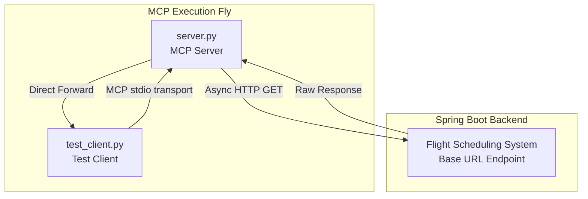
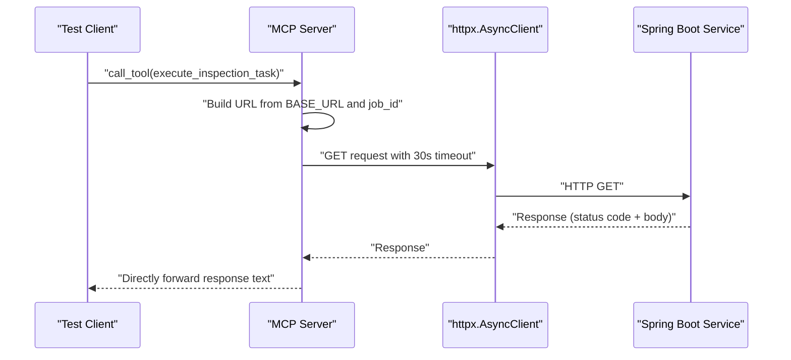
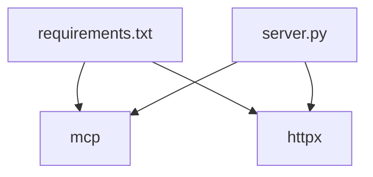

# HTTP Communication Layer

<cite>
**Referenced Files in This Document**
- [server.py](file://server.py)
- [test_client.py](file://test_client.py)
- [requirements.txt](file://requirements.txt)
- [server copy.py](file://server copy.py)
- [test_client copy.py](file://test_client copy.py)
</cite>

## Table of Contents
1. [Introduction](#introduction)
2. [Project Structure](#project-structure)
3. [Core Components](#core-components)
4. [Architecture Overview](#architecture-overview)
5. [Detailed Component Analysis](#detailed-component-analysis)
6. [Dependency Analysis](#dependency-analysis)
7. [Performance Considerations](#performance-considerations)
8. [Troubleshooting Guide](#troubleshooting-guide)
9. [Conclusion](#conclusion)

## Introduction
This document describes the HTTP Communication Layer that connects the MCP Execution Fly to a Spring Boot backend service. It focuses on the asynchronous HTTP client implementation using httpx.AsyncClient, timeout configuration, URL construction patterns, and error handling mechanisms for network connectivity issues. The implementation demonstrates direct response forwarding from the backend service to the client, preserving raw responses without additional parsing or success/failure interpretation.

## Project Structure
The project consists of a minimal Python application that exposes an MCP tool to trigger flight inspection tasks. The tool constructs a URL from a configured base endpoint and forwards the request to a Spring Boot service. The client-side test script demonstrates how to discover and invoke the tool via MCP.

**Diagram sources**
- [server.py:26-29](file://server.py#L26-L29)
- [server.py:54-65](file://server.py#L54-L65)
- [test_client.py:16-42](file://test_client.py#L16-L42)

**Section sources**
- [server.py:1-90](file://server.py#L1-L90)
- [test_client.py:1-45](file://test_client.py#L1-L45)

## Core Components
- MCP Server and Tool Definition
  - The MCP server is initialized with a descriptive name and registers a tool named execute_inspection_task.
  - The tool accepts a job identifier and performs an HTTP GET against a constructed URL derived from a base endpoint and the job ID.
  - The tool returns the raw response body received from the backend service.

- HTTP Client and Configuration
  - An httpx.AsyncClient is created with a timeout of 30 seconds.
  - The client performs a GET request to the constructed URL and logs both the status code and response text.
  - The response text is forwarded directly to the caller without additional processing.

- Base URL and URL Construction
  - The backend service base URL is defined as a module-level constant.
  - The final URL is formed by appending the job_id as a path segment to the base URL.

- Error Handling
  - Specific exceptions for connection failures and timeouts are caught and translated into user-friendly messages.
  - General exceptions are logged with stack traces and returned as a standardized error message.

- Logging
  - Comprehensive logging is enabled to capture request URLs, response status codes, and error conditions.

**Section sources**
- [server.py:26-29](file://server.py#L26-L29)
- [server.py:35-76](file://server.py#L35-L76)
- [server.py:54-65](file://server.py#L54-L65)
- [server.py:14-21](file://server.py#L14-L21)

## Architecture Overview
The communication flow follows a straightforward pipeline: the client invokes an MCP tool, the server constructs a URL, performs an asynchronous HTTP GET, and returns the backend’s raw response to the client.

**Diagram sources**
- [server.py:35-76](file://server.py#L35-L76)
- [server.py:54-65](file://server.py#L54-L65)
- [test_client.py:34-42](file://test_client.py#L34-L42)

## Detailed Component Analysis

### HTTP Client Implementation
- Asynchronous Client Creation
  - The AsyncClient is instantiated within an async context manager, ensuring proper lifecycle management.
  - The client is configured with a timeout of 30 seconds for all requests.

- Request Execution
  - The tool performs a GET request to the constructed URL.
  - Both the status code and textual response are logged for observability.

- Response Forwarding
  - The raw response text is returned directly to the caller, preserving backend-specific formatting and semantics.

- Timeout Management
  - The timeout setting ensures that long-running or unresponsive backend services do not block the tool indefinitely.

**Section sources**
- [server.py:57-65](file://server.py#L57-L65)

### URL Construction and Base Configuration
- Base URL
  - The backend service base URL is defined as a module-level constant and serves as the foundation for all downstream requests.

- Path Construction
  - The job_id is appended as a path segment to form the complete endpoint URL used for the GET request.

- Logging
  - The constructed URL is logged to aid in debugging and monitoring.

**Section sources**
- [server.py:29](file://server.py#L29)
- [server.py:54](file://server.py#L54)

### Error Handling Mechanisms
- Connection Failure (ConnectError)
  - When the client cannot establish a connection to the backend, a user-friendly message is returned indicating the service may be down or unreachable.

- Timeout (TimeoutException)
  - When the backend does not respond within the configured 30-second window, a timeout message is returned.

- General Exceptions
  - Unexpected errors are logged with stack traces and returned as a standardized error message.

- Logging Integration
  - All exceptions are logged with contextual information to support troubleshooting.

**Section sources**
- [server.py:67-75](file://server.py#L67-L75)

### Status Code Handling
- The tool does not interpret the backend’s status codes. Instead, it logs the status code and forwards the raw response text to the client.
- This approach preserves backend-defined semantics and allows clients to decide how to handle different outcomes.

**Section sources**
- [server.py:59-65](file://server.py#L59-L65)

### Example Request/Response Cycles
- Successful Request
  - The client invokes the tool with a job_id.
  - The server constructs the URL and sends an HTTP GET.
  - The backend responds with a successful status and body.
  - The server logs the status and returns the raw response text to the client.

- Connection Failure
  - The client invokes the tool.
  - The server attempts to connect but fails.
  - The server logs the error and returns a user-friendly message indicating the service may be down.

- Timeout
  - The client invokes the tool.
  - The server initiates the request but receives no response within 30 seconds.
  - The server logs the timeout and returns a timeout message.

**Section sources**
- [test_client.py:34-42](file://test_client.py#L34-L42)
- [server.py:57-75](file://server.py#L57-L75)

### Integration Patterns with Backend Service
- Direct Response Forwarding
  - The server forwards the backend’s raw response text to the client without parsing or validation.
  - This pattern simplifies integration and avoids tight coupling to specific response formats.

- Transport Modes
  - The MCP server supports stdio mode for local development and SSE mode for remote deployment scenarios.

**Section sources**
- [server.py:63-65](file://server.py#L63-L65)
- [server.py:86-90](file://server.py#L86-L90)

## Dependency Analysis
The project relies on two primary dependencies:
- mcp: Provides the MCP framework for tool discovery and invocation.
- httpx: Supplies the asynchronous HTTP client with timeout support.

**Diagram sources**
- [requirements.txt:1-2](file://requirements.txt#L1-L2)
- [server.py:5](file://server.py#L5)

**Section sources**
- [requirements.txt:1-2](file://requirements.txt#L1-L2)

## Performance Considerations
- Timeout Configuration
  - The 30-second timeout balances responsiveness with tolerance for backend latency. Adjustments may be needed based on observed backend performance characteristics.

- Logging Overhead
  - Logging at INFO level captures sufficient detail for debugging while minimizing overhead. Consider reducing log verbosity in production environments.

- Asynchronous I/O
  - Using httpx.AsyncClient enables concurrent handling of multiple requests, improving throughput under load.

## Troubleshooting Guide
- Verify Backend Availability
  - Ensure the Spring Boot service is reachable at the configured BASE_URL and listening on the expected port.

- Check Network Connectivity
  - Confirm firewall rules and network policies allow outbound connections from the MCP server to the backend service.

- Inspect Logs
  - Review server logs for request URLs, status codes, and error messages to diagnose connectivity and timeout issues.

- Validate Job ID Format
  - Ensure the job_id passed to the tool matches the expected format on the backend service.

- Transport Mode Selection
  - For local development, use stdio transport. For remote deployments, configure SSE transport with appropriate host and port settings.

**Section sources**
- [server.py:14-21](file://server.py#L14-L21)
- [server.py:86-90](file://server.py#L86-L90)

## Conclusion
The HTTP Communication Layer provides a clean, robust bridge between the MCP Execution Fly and the Spring Boot backend. By leveraging httpx.AsyncClient with a 30-second timeout, constructing URLs from a configurable base, and forwarding backend responses directly to clients, the implementation remains simple, observable, and adaptable. Proper logging and explicit error handling further enhance reliability and maintainability.