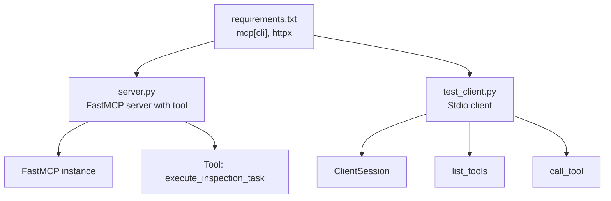
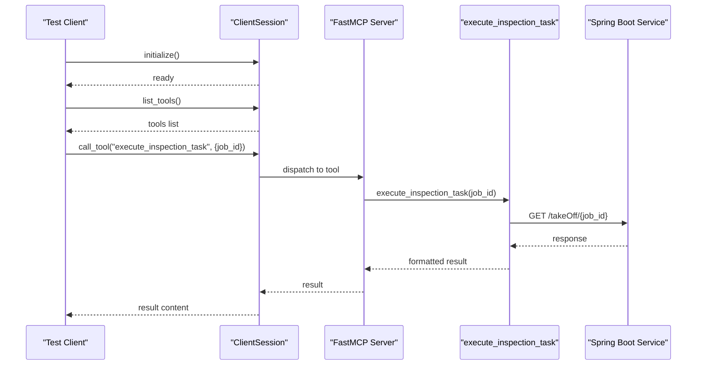
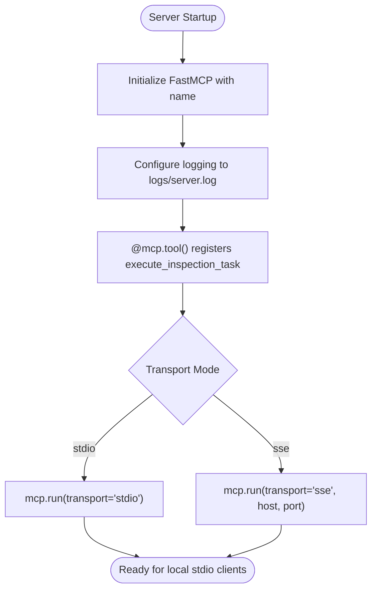
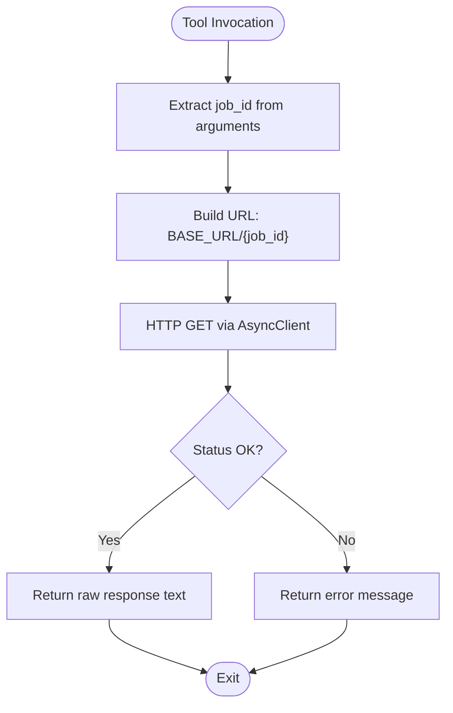
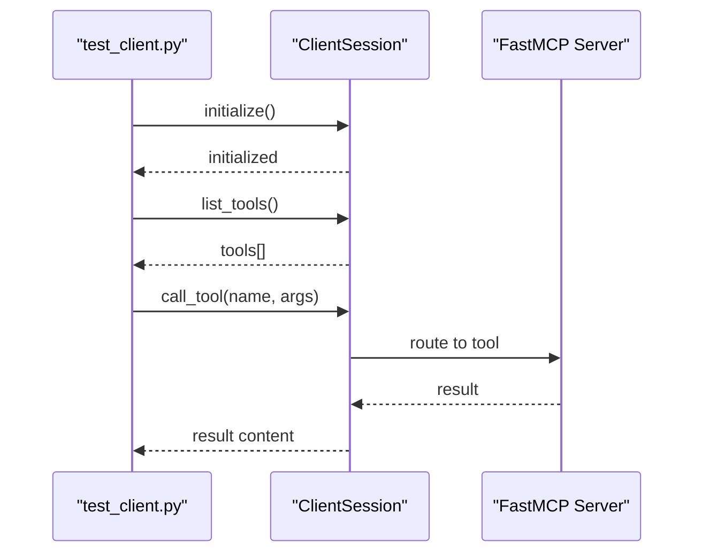
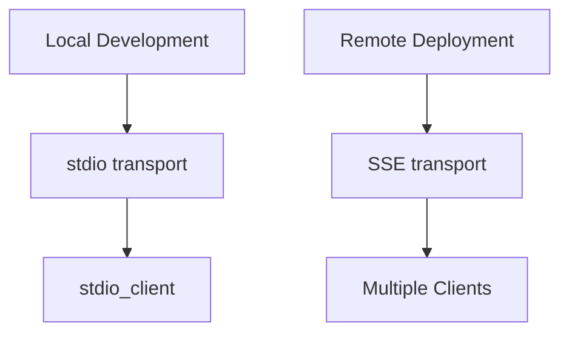
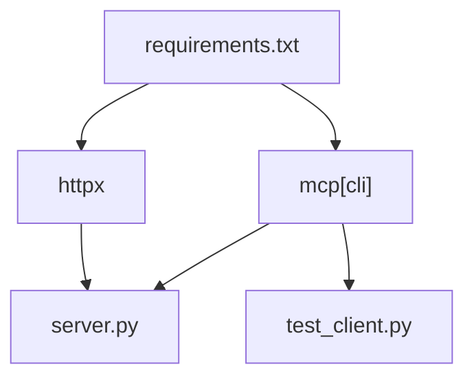

# MCP Protocol Integration

<cite>
**Referenced Files in This Document**
- [server.py](file://server.py)
- [server copy.py](file://server copy.py)
- [test_client.py](file://test_client.py)
- [test_client copy.py](file://test_client copy.py)
- [requirements.txt](file://requirements.txt)
</cite>

## Table of Contents
1. [Introduction](#introduction)
2. [Project Structure](#project-structure)
3. [Core Components](#core-components)
4. [Architecture Overview](#architecture-overview)
5. [Detailed Component Analysis](#detailed-component-analysis)
6. [Dependency Analysis](#dependency-analysis)
7. [Performance Considerations](#performance-considerations)
8. [Troubleshooting Guide](#troubleshooting-guide)
9. [Conclusion](#conclusion)

## Introduction
This document explains the MCP Protocol Integration implemented in the MCP Execution Fly project. It focuses on the FastMCP server, tool definition and registration using the @mcp.tool() decorator, session management, and transport configuration options. It also documents the tool discovery mechanism via list_tools and tool execution via call_tool endpoints, compares stdio transport for local development with SSE transport for remote deployment, and provides practical examples of agent interactions, parameter extraction from natural language, and response formatting. Finally, it outlines common integration patterns and troubleshooting steps for MCP protocol communication issues.

## Project Structure
The repository contains minimal yet focused files that demonstrate a complete MCP server implementation with a single tool and a test client for local development.

**Diagram sources**
- [server.py:26](file://server.py#L26)
- [server.py:35-76](file://server.py#L35-L76)
- [test_client.py:24-42](file://test_client.py#L24-L42)
- [requirements.txt:1-2](file://requirements.txt#L1-L2)

**Section sources**
- [server.py:1-90](file://server.py#L1-L90)
- [test_client.py:1-45](file://test_client.py#L1-L45)
- [requirements.txt:1-2](file://requirements.txt#L1-L2)

## Core Components
- FastMCP Server Instance: Created with a server identifier and configured with logging to a dedicated log file.
- Tool Definition: A single asynchronous tool decorated with @mcp.tool(), named execute_inspection_task, designed to accept a job_id argument and forward it to a backend service.
- Session Management: The test client demonstrates initializing a ClientSession, listing tools, and invoking a tool with structured arguments.
- Transport Configuration: The server supports stdio transport for local development and SSE transport for remote deployments.

Key implementation references:
- FastMCP instantiation and logging configuration: [server.py:26](file://server.py#L26), [server.py:14-21](file://server.py#L14-L21)
- Tool definition and registration: [server.py:35-76](file://server.py#L35-L76)
- Tool execution flow and error handling: [server.py:57-75](file://server.py#L57-L75)
- Client session initialization and tool invocation: [test_client.py:24-42](file://test_client.py#L24-L42)
- Transport selection for stdio and SSE: [server.py:87-90](file://server.py#L87-L90)

**Section sources**
- [server.py:26](file://server.py#L26)
- [server.py:35-76](file://server.py#L35-L76)
- [test_client.py:24-42](file://test_client.py#L24-L42)
- [server.py:87-90](file://server.py#L87-L90)

## Architecture Overview
The system follows a client–server model compliant with the MCP protocol. The server exposes a single tool that bridges to an external backend service. The client initializes a session, discovers tools, and invokes the tool with arguments.

**Diagram sources**
- [test_client.py:24-42](file://test_client.py#L24-L42)
- [server.py:35-76](file://server.py#L35-L76)

## Detailed Component Analysis

### FastMCP Server Implementation
- Server Creation: The server is instantiated with a descriptive name and configured with file-based logging to a logs directory.
- Logging Setup: Logs are written to a server.log file under the logs directory with timestamps and severity levels.
- Tool Registration: The @mcp.tool() decorator registers the execute_inspection_task tool with the server.
- Tool Behavior: The tool extracts a job_id parameter, constructs a URL to a backend service, performs an asynchronous HTTP GET request, and returns the raw response text or a user-friendly error message.
- Transport Options: The server supports stdio transport for local development and SSE transport for remote deployments.

**Diagram sources**
- [server.py:26](file://server.py#L26)
- [server.py:14-21](file://server.py#L14-L21)
- [server.py:35](file://server.py#L35)
- [server.py:87-90](file://server.py#L87-L90)

**Section sources**
- [server.py:26](file://server.py#L26)
- [server.py:14-21](file://server.py#L14-L21)
- [server.py:35](file://server.py#L35)
- [server.py:87-90](file://server.py#L87-L90)

### Tool Definition and Registration
- Decorator Usage: The @mcp.tool() decorator registers the tool with the server, exposing it to clients during discovery.
- Parameter Extraction: The tool expects a job_id argument. The implementation treats it as a string and appends it to the backend URL path.
- Backend Interaction: The tool makes an asynchronous HTTP GET request to a configured base URL plus the job_id.
- Response Handling: The tool returns the backend’s raw response text or a descriptive error message depending on the outcome.

**Diagram sources**
- [server.py:35-76](file://server.py#L35-L76)

**Section sources**
- [server.py:35-76](file://server.py#L35-L76)

### Session Management and Tool Discovery
- Client Initialization: The test client creates StdioServerParameters pointing to the server script and establishes a stdio connection.
- Session Lifecycle: A ClientSession is opened, initialized, and used to discover tools and invoke them.
- Tool Discovery: list_tools returns a list of tools registered with the server, enabling dynamic selection by agents.
- Tool Execution: call_tool accepts the tool name and a dictionary of arguments, returning the tool’s result content.

**Diagram sources**
- [test_client.py:24-42](file://test_client.py#L24-L42)

**Section sources**
- [test_client.py:24-42](file://test_client.py#L24-L42)

### Transport Configuration Options
- stdio Transport (Local Development):
  - Purpose: Ideal for local testing with desktop clients.
  - Usage: mcp.run(transport="stdio") starts the server in stdio mode.
  - Client Connection: stdio_client connects to the server via stdio streams.
- SSE Transport (Remote Deployment):
  - Purpose: Enables multiple clients to connect to a single server instance.
  - Usage: mcp.run(transport="sse", host="0.0.0.0", port=9000) starts the server in SSE mode.
  - Scalability: Suitable for production environments where multiple agents need to communicate with the server.

**Diagram sources**
- [server.py:87-90](file://server.py#L87-L90)
- [test_client.py:16-19](file://test_client.py#L16-L19)

**Section sources**
- [server.py:87-90](file://server.py#L87-L90)
- [test_client.py:16-19](file://test_client.py#L16-L19)

### Practical Agent Interaction Examples
- Natural Language Intent Recognition:
  - Example prompts: “Execute inspection task 12345”, “Take off flight ABC-001”, “Start patrol for 67890”.
  - Parameter Extraction: Agents extract a job_id from the prompt and pass it as an argument to the tool.
- Response Formatting:
  - The tool returns the backend’s raw response text. For improved UX, consider parsing JSON responses and formatting human-readable summaries.
- Example Workflows:
  - Discovery: Agent calls list_tools to discover available tools.
  - Invocation: Agent calls call_tool with the tool name and extracted arguments.
  - Result Handling: Agent reads result.content[0].text and processes accordingly.

**Section sources**
- [server.py:35-76](file://server.py#L35-L76)
- [test_client.py:28-42](file://test_client.py#L28-L42)

## Dependency Analysis
The project relies on two primary dependencies:
- mcp[cli]: Provides the FastMCP server framework and client session abstractions.
- httpx: Enables asynchronous HTTP requests to the backend service.

**Diagram sources**
- [requirements.txt:1-2](file://requirements.txt#L1-L2)
- [server.py:6](file://server.py#L6)
- [test_client.py:3](file://test_client.py#L3)

**Section sources**
- [requirements.txt:1-2](file://requirements.txt#L1-L2)
- [server.py:6](file://server.py#L6)
- [test_client.py:3](file://test_client.py#L3)

## Performance Considerations
- Asynchronous I/O: The tool uses an asynchronous HTTP client to avoid blocking the event loop, improving responsiveness under concurrent loads.
- Timeout Configuration: A 30-second timeout prevents indefinite waits for backend responses.
- Logging Overhead: File-based logging is enabled; ensure log rotation in production to manage disk usage.
- Transport Choice: SSE enables horizontal scaling across multiple clients, while stdio is simpler for local development.

[No sources needed since this section provides general guidance]

## Troubleshooting Guide
Common issues and resolutions:
- Connection Failures:
  - Symptom: Error indicating inability to connect to the backend service.
  - Resolution: Verify the backend service is reachable at the configured BASE_URL and that network policies allow outbound connections.
- Request Timeouts:
  - Symptom: Timeout errors when calling the tool.
  - Resolution: Increase the timeout value or optimize backend response times.
- Tool Not Found:
  - Symptom: call_tool fails because the tool name does not match the registered tool.
  - Resolution: Confirm the tool name used in call_tool matches the registered tool name exactly.
- Transport Mismatch:
  - Symptom: Client cannot connect when the server runs in a different transport mode.
  - Resolution: Ensure the client uses stdio_client for stdio mode or configure the client to connect to the SSE endpoint for SSE mode.
- Logging and Diagnostics:
  - Enable debug logging to capture detailed entries in logs/server.log for diagnosing runtime issues.

**Section sources**
- [server.py:67-75](file://server.py#L67-L75)
- [server.py:14-21](file://server.py#L14-L21)

## Conclusion
The MCP Execution Fly project demonstrates a clean and minimal implementation of an MCP-compliant server using FastMCP. It registers a single tool, manages sessions, and supports both stdio and SSE transports. The included test client illustrates tool discovery and invocation. By following the patterns shown here, developers can integrate AI agents with backend systems using the MCP protocol, extract parameters from natural language, and return formatted responses tailored to agent workflows.