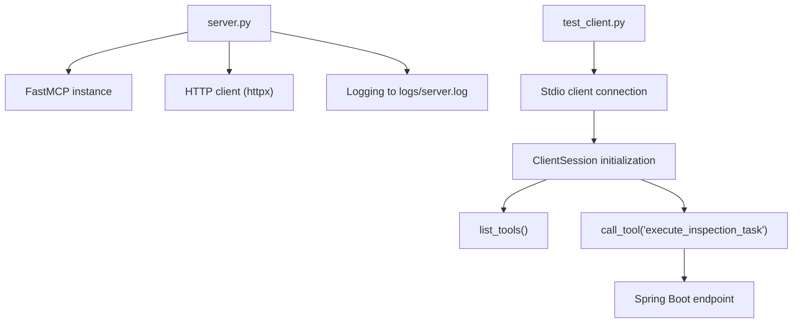
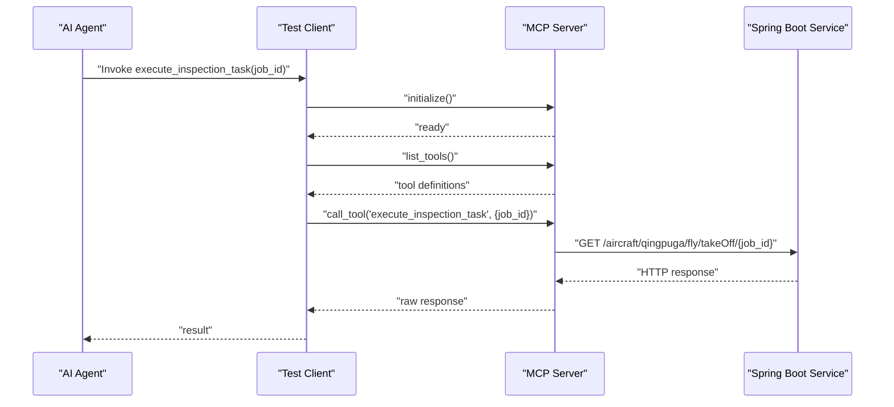
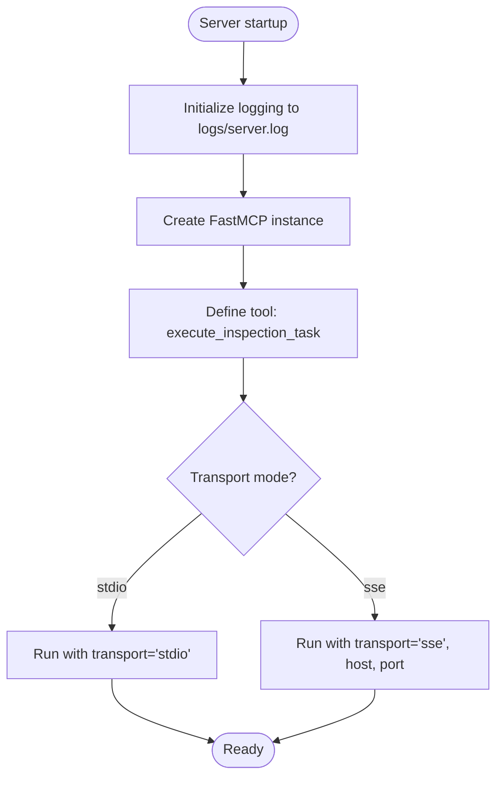
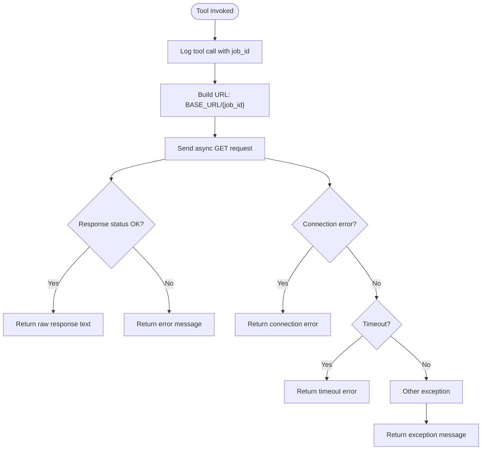
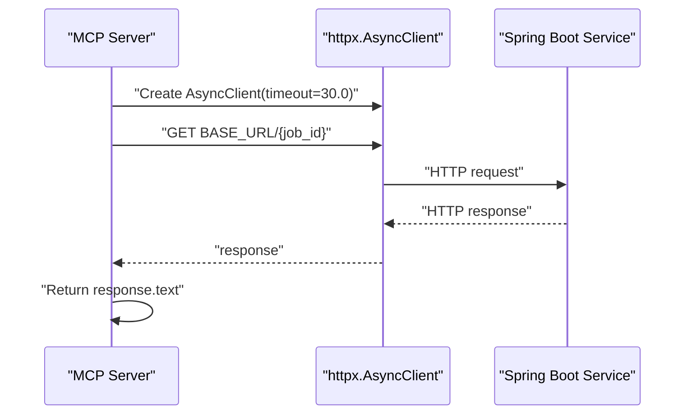
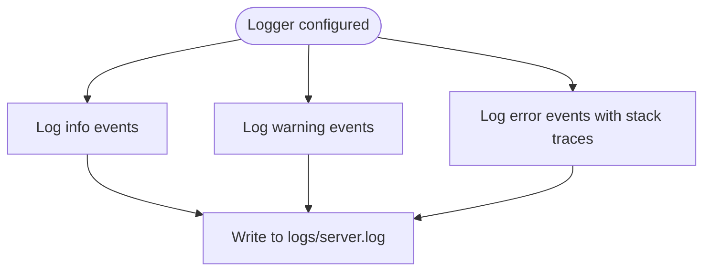
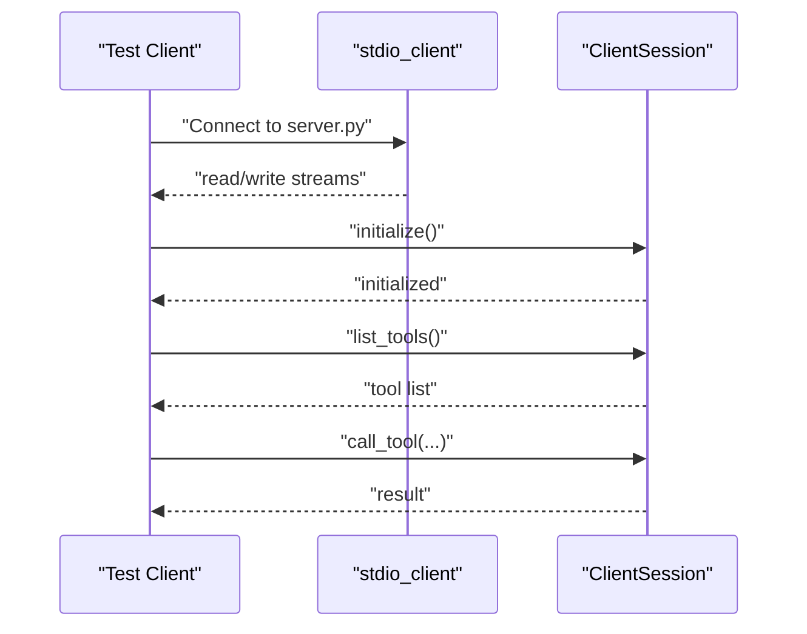
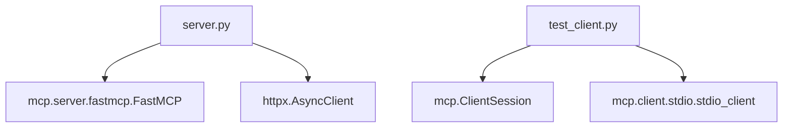

# Project Overview

<cite>
**Referenced Files in This Document**
- [server.py](file://server.py)
- [server copy.py](file://server copy.py)
- [test_client.py](file://test_client.py)
- [test_client copy.py](file://test_client copy.py)
- [requirements.txt](file://requirements.txt)
- [.gitignore](file://.gitignore)
</cite>

## Table of Contents
1. [Introduction](#introduction)
2. [Project Structure](#project-structure)
3. [Core Components](#core-components)
4. [Architecture Overview](#architecture-overview)
5. [Detailed Component Analysis](#detailed-component-analysis)
6. [Dependency Analysis](#dependency-analysis)
7. [Performance Considerations](#performance-considerations)
8. [Troubleshooting Guide](#troubleshooting-guide)
9. [Conclusion](#conclusion)
10. [Appendices](#appendices)

## Introduction
MCP Execution Fly is a flight inspection task automation system that integrates AI agents with a Spring Boot backend service for unmanned aerial vehicle (UAV) operations. The project demonstrates how the Model Context Protocol (MCP) enables AI agents to discover and invoke tools that orchestrate real-world actions, such as commanding a UAV to execute inspection missions. The system exposes a single tool definition named execute_inspection_task, which accepts a job identifier and forwards it to a remote Spring Boot service endpoint responsible for flight scheduling and takeoff commands.

Key goals of the project:
- Provide a minimal yet realistic example of AI-driven UAV mission automation
- Showcase MCP’s tool discovery and invocation model
- Demonstrate multi-transport support for local development (stdio) and remote deployment (SSE)
- Integrate HTTP communication with robust error handling and logging

## Project Structure
The repository is intentionally compact, containing four primary files plus a requirements specification and a version control ignore list. The structure emphasizes clarity and ease of understanding for both beginners and experienced developers.

**Diagram sources**
- [server.py:26](file://server.py#L26)
- [server.py:57](file://server.py#L57)
- [server.py:86](file://server.py#L86)
- [test_client.py:21](file://test_client.py#L21)
- [test_client.py:24](file://test_client.py#L24)
- [test_client.py:37](file://test_client.py#L37)

**Section sources**
- [server.py:1-90](file://server.py#L1-L90)
- [test_client.py:1-45](file://test_client.py#L1-L45)
- [requirements.txt:1-2](file://requirements.txt#L1-L2)
- [.gitignore:1-54](file://.gitignore#L1-L54)

## Core Components
- FastMCP server: Creates an MCP server instance and registers a tool definition for execute_inspection_task. It supports multiple transport modes, including stdio for local development and SSE for remote clients.
- Tool definition: A single async tool that accepts a job identifier and forwards it to a Spring Boot endpoint. The tool encapsulates the logic for building the request URL and handling HTTP responses.
- HTTP communication layer: Uses httpx to asynchronously communicate with the Spring Boot service, including timeout and connection error handling.
- Logging infrastructure: Configures file-based logging to logs/server.log with structured messages for operational visibility.
- Test client: Demonstrates stdio-based client connectivity, tool listing, and tool invocation against the server.

Practical example:
- An AI agent describes a flight inspection task and provides a job identifier. The agent invokes the registered tool, which constructs a request to the Spring Boot service and returns the raw response to the agent.

**Section sources**
- [server.py:26](file://server.py#L26)
- [server.py:35](file://server.py#L35)
- [server.py:57](file://server.py#L57)
- [server.py:14](file://server.py#L14)
- [test_client.py:21](file://test_client.py#L21)

## Architecture Overview
The system follows a simple, layered architecture:
- Client-side (Agent): Uses stdio to connect to the MCP server and discovers/calls tools.
- MCP Server: Exposes the tool definition and routes requests to the Spring Boot backend.
- Backend Service: Receives the request, performs flight scheduling, and responds with a status/result.

**Diagram sources**
- [test_client.py:24](file://test_client.py#L24)
- [test_client.py:37](file://test_client.py#L37)
- [server.py:54](file://server.py#L54)
- [server.py:59](file://server.py#L59)

## Detailed Component Analysis

### FastMCP Server
The server initializes logging, creates a FastMCP instance, defines a single tool, and starts the server in either stdio or SSE transport mode. It includes comprehensive error handling for network failures and timeouts.

**Diagram sources**
- [server.py:14](file://server.py#L14)
- [server.py:26](file://server.py#L26)
- [server.py:35](file://server.py#L35)
- [server.py:86](file://server.py#L86)

**Section sources**
- [server.py:14](file://server.py#L14)
- [server.py:26](file://server.py#L26)
- [server.py:86](file://server.py#L86)

### Tool Definition: execute_inspection_task
This tool definition serves as the bridge between the AI agent and the Spring Boot backend. It:
- Logs incoming tool invocations
- Builds the target URL using the provided job identifier
- Sends an asynchronous GET request to the backend
- Returns the raw response text to the caller
- Handles connection errors, timeouts, and unexpected exceptions

**Diagram sources**
- [server.py:51](file://server.py#L51)
- [server.py:54](file://server.py#L54)
- [server.py:59](file://server.py#L59)
- [server.py:67](file://server.py#L67)
- [server.py:70](file://server.py#L70)
- [server.py:73](file://server.py#L73)

**Section sources**
- [server.py:35](file://server.py#L35)
- [server.py:51](file://server.py#L51)
- [server.py:54](file://server.py#L54)
- [server.py:59](file://server.py#L59)
- [server.py:67](file://server.py#L67)
- [server.py:70](file://server.py#L70)
- [server.py:73](file://server.py#L73)

### HTTP Communication Layer
The server uses httpx to perform asynchronous HTTP requests. It sets a timeout and handles various error conditions, returning user-friendly messages while preserving the original backend response for transparency.

**Diagram sources**
- [server.py:57](file://server.py#L57)
- [server.py:59](file://server.py#L59)

**Section sources**
- [server.py:57](file://server.py#L57)
- [server.py:59](file://server.py#L59)

### Logging Infrastructure
The server configures file-based logging to logs/server.log with timestamps and log levels. It logs tool invocations, request URLs, response statuses, and error conditions to aid debugging and monitoring.

**Diagram sources**
- [server.py:14](file://server.py#L14)
- [server.py:21](file://server.py#L21)
- [server.py:51](file://server.py#L51)
- [server.py:67](file://server.py#L67)

**Section sources**
- [server.py:14](file://server.py#L14)
- [server.py:21](file://server.py#L21)
- [server.py:51](file://server.py#L51)
- [server.py:67](file://server.py#L67)

### Test Client
The test client demonstrates stdio-based connectivity to the MCP server. It:
- Establishes a stdio connection to the server process
- Initializes a client session
- Lists available tools
- Invokes the execute_inspection_task tool with a job identifier
- Prints the resulting content

**Diagram sources**
- [test_client.py:21](file://test_client.py#L21)
- [test_client.py:24](file://test_client.py#L24)
- [test_client.py:37](file://test_client.py#L37)

**Section sources**
- [test_client.py:13](file://test_client.py#L13)
- [test_client.py:21](file://test_client.py#L21)
- [test_client.py:24](file://test_client.py#L24)
- [test_client.py:37](file://test_client.py#L37)

### Conceptual Overview
For beginners unfamiliar with MCP:
- MCP is a protocol that allows AI agents to discover and invoke tools provided by servers. In this project, the server advertises a single tool that orchestrates UAV inspection tasks by communicating with a Spring Boot backend.
- The tool definition describes what the agent can do and under what conditions the agent should call it.
- Transport modes define how the agent connects to the server:
  - stdio: suitable for local development and desktop applications
  - SSE: suitable for remote deployments where multiple clients can connect

For experienced developers:
- FastMCP simplifies server creation and tool registration.
- The tool definition is an async function annotated with @mcp.tool(), enabling the agent to discover and call it.
- Multi-transport support is configured via mcp.run(transport="...").
- HTTP communication uses httpx for robust asynchronous requests with explicit error handling.

[No sources needed since this section provides conceptual guidance]

## Dependency Analysis
The project depends on two libraries:
- mcp[cli]: Provides the FastMCP server framework and client utilities for stdio transport
- httpx: Enables asynchronous HTTP communication with the Spring Boot backend

**Diagram sources**
- [server.py:6](file://server.py#L6)
- [server.py:57](file://server.py#L57)
- [test_client.py:3](file://test_client.py#L3)
- [test_client.py:4](file://test_client.py#L4)

**Section sources**
- [requirements.txt:1](file://requirements.txt#L1)
- [requirements.txt:2](file://requirements.txt#L2)

## Performance Considerations
- Asynchronous HTTP requests: Using httpx.AsyncClient ensures non-blocking I/O during network operations, improving responsiveness under concurrent loads.
- Timeout configuration: A 30-second timeout prevents indefinite waits for backend responses, balancing reliability with performance.
- Logging overhead: File-based logging is synchronous and can become a bottleneck under high load; consider rotating logs and adjusting verbosity in production environments.
- Transport selection: stdio is efficient for local development, while SSE introduces network overhead suitable for distributed deployments.

[No sources needed since this section provides general guidance]

## Troubleshooting Guide
Common issues and resolutions:
- Connection failures to the Spring Boot service:
  - Verify the BASE_URL is reachable from the server host.
  - Confirm the backend service is running and listening on the expected port.
- Timeouts:
  - Increase the timeout value if the backend requires more time to process requests.
  - Investigate backend performance and network latency.
- Tool invocation errors:
  - Ensure the tool name matches exactly ("execute_inspection_task").
  - Confirm the job identifier is provided and valid.
- Logging:
  - Check logs/server.log for detailed entries and stack traces to diagnose runtime issues.

**Section sources**
- [server.py:67](file://server.py#L67)
- [server.py:70](file://server.py#L70)
- [server.py:73](file://server.py#L73)

## Conclusion
MCP Execution Fly demonstrates a practical integration of AI agents with real-world systems for UAV mission automation. By exposing a single, well-defined tool and leveraging MCP’s transport modes, the project provides a clear blueprint for building AI-driven control systems. The combination of FastMCP, HTTP communication, and structured logging offers a solid foundation for extending the system to support additional tools, transports, and backend integrations.

[No sources needed since this section summarizes without analyzing specific files]

## Appendices
- Practical example scenarios:
  - Local development: Run the server in stdio mode and use the test client to list tools and invoke the inspection task.
  - Remote deployment: Switch the server to SSE mode and connect multiple clients to the same endpoint.
  - Backend integration: Extend the tool definition to handle additional parameters or return structured JSON responses for richer agent interactions.

[No sources needed since this section provides general guidance]