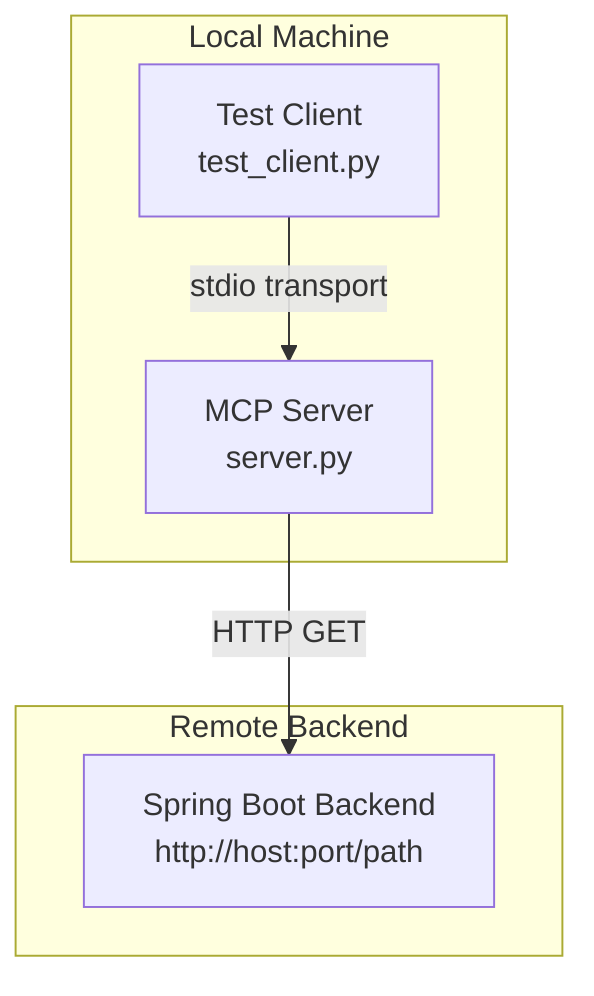
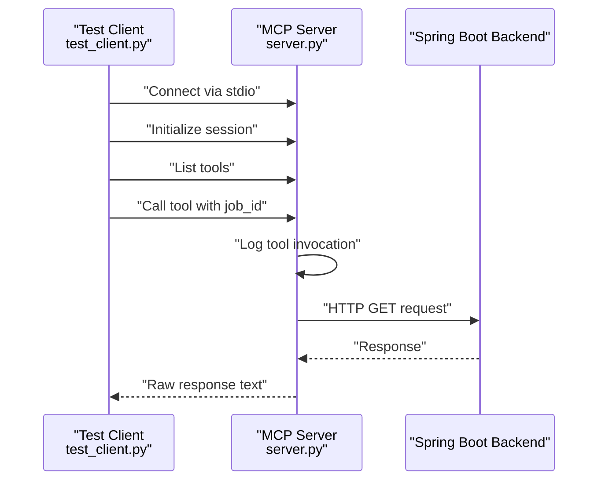
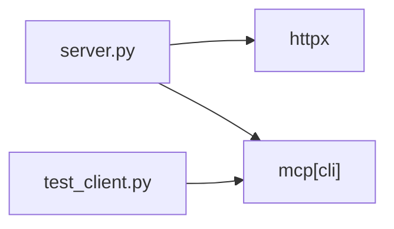
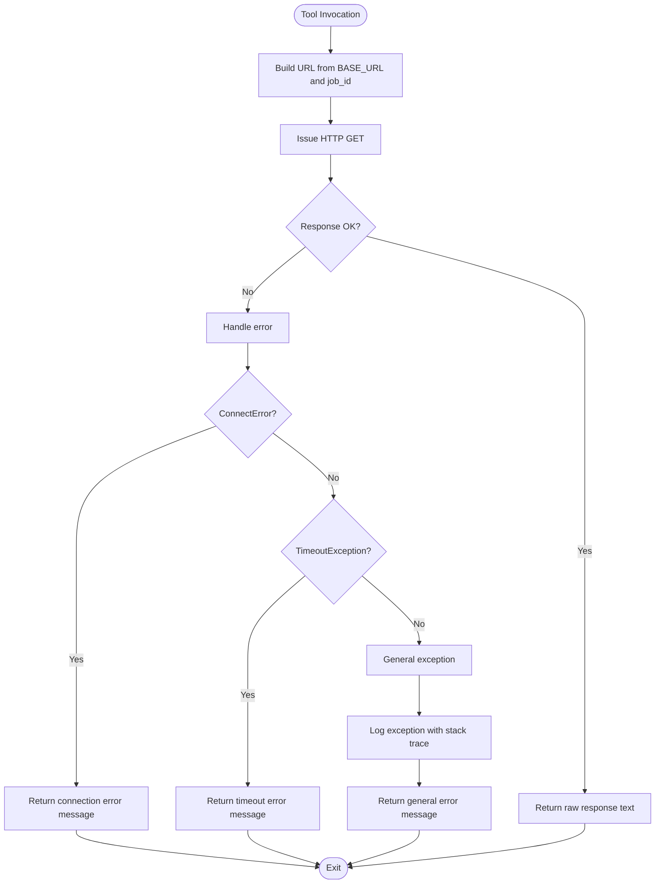

# Troubleshooting

<cite>
**Referenced Files in This Document**
- [server.py](file://server.py)
- [test_client.py](file://test_client.py)
- [requirements.txt](file://requirements.txt)
- [server copy.py](file://server copy.py)
- [test_client copy.py](file://test_client copy.py)
</cite>

## Table of Contents
1. [Introduction](#introduction)
2. [Project Structure](#project-structure)
3. [Core Components](#core-components)
4. [Architecture Overview](#architecture-overview)
5. [Detailed Component Analysis](#detailed-component-analysis)
6. [Dependency Analysis](#dependency-analysis)
7. [Performance Considerations](#performance-considerations)
8. [Troubleshooting Guide](#troubleshooting-guide)
9. [Conclusion](#conclusion)
10. [Appendices](#appendices)

## Introduction
This document provides comprehensive troubleshooting guidance for MCP Execution Fly. It focuses on diagnosing and resolving common issues such as network connectivity problems to the Spring Boot backend, timeout errors during HTTP requests, and MCP protocol communication failures. It also explains logging configuration and how to interpret logs in logs/server.log, along with transport mode switching between stdio and SSE, error handling for ConnectError and TimeoutException, and general exception management. Step-by-step diagnostic procedures, common error messages, and resolution strategies are included, alongside performance and resource considerations for optimal operation.

## Project Structure
The project consists of a minimal MCP server implementation and a test client that exercises the server via stdio transport. Key files:
- server.py: Implements the MCP server, defines the tool, performs HTTP GET requests to a Spring Boot backend, and writes structured logs to logs/server.log.
- test_client.py: Demonstrates connecting to the server via stdio and invoking the tool.
- requirements.txt: Declares external dependencies (mcp and httpx).
- server copy.py and test_client copy.py: Alternative implementations with different logging approaches and comments indicating SSE transport support.

**Diagram sources**
- [server.py:86-90](file://server.py#L86-L90)
- [test_client.py:16-21](file://test_client.py#L16-L21)

**Section sources**
- [server.py:1-90](file://server.py#L1-L90)
- [test_client.py:1-45](file://test_client.py#L1-L45)
- [requirements.txt:1-2](file://requirements.txt#L1-L2)

## Core Components
- MCP Server (FastMCP): Exposes a tool named execute_inspection_task. It accepts a job_id argument and forwards it to the configured Spring Boot endpoint via HTTP GET.
- HTTP Client: Uses httpx.AsyncClient with a fixed timeout of 30 seconds for outbound requests.
- Logging: Configured to write to logs/server.log with DEBUG level and a timestamped format.
- Transport Modes:
  - stdio: Local development and testing with clients like Claude Desktop.
  - sse: Remote deployment mode for multiple concurrent clients.

Key implementation references:
- Tool definition and HTTP request logic: [server.py:35-76](file://server.py#L35-L76)
- Logging configuration and handler: [server.py:14-21](file://server.py#L14-L21)
- Startup and transport selection: [server.py:81-90](file://server.py#L81-L90)
- Test client stdio connection: [test_client.py:16-26](file://test_client.py#L16-L26)

**Section sources**
- [server.py:35-76](file://server.py#L35-L76)
- [server.py:14-21](file://server.py#L14-L21)
- [server.py:81-90](file://server.py#L81-L90)
- [test_client.py:16-26](file://test_client.py#L16-L26)

## Architecture Overview
The system follows a simple request-response flow:
- The client connects to the MCP server via stdio.
- The client initializes a session and lists tools.
- The client invokes execute_inspection_task with a job_id.
- The server logs the tool invocation, constructs a URL from BASE_URL and job_id, and performs an HTTP GET to the Spring Boot backend.
- The server returns the raw response body to the client.

**Diagram sources**
- [test_client.py:24-42](file://test_client.py#L24-L42)
- [server.py:35-76](file://server.py#L35-L76)

## Detailed Component Analysis

### Tool: execute_inspection_task
Purpose:
- Accepts a job_id argument.
- Logs the incoming request and target URL.
- Issues an HTTP GET to the configured BASE_URL plus job_id.
- Returns the raw response text from the backend.

Error handling:
- Catches httpx.ConnectError and returns a user-friendly message suggesting the backend service may be down or unreachable.
- Catches httpx.TimeoutException and returns a message indicating the request timed out after 30 seconds.
- Catches general exceptions and logs stack traces for debugging.

Transport modes:
- stdio: Used by the test client and default startup.
- sse: Available via commented startup option.

Operational notes:
- The server does not parse or validate the backend response; it returns the raw text.
- The timeout is fixed at 30 seconds.

References:
- Tool definition and logic: [server.py:35-76](file://server.py#L35-L76)
- Startup transport selection: [server.py:86-90](file://server.py#L86-L90)

**Section sources**
- [server.py:35-76](file://server.py#L35-L76)
- [server.py:86-90](file://server.py#L86-L90)

### Logging Configuration and Interpretation
Logging configuration:
- Output directory: logs/server.log under the script’s directory.
- Log level: DEBUG.
- Format: Timestamped entries with severity and message.

Interpretation tips:
- Look for lines containing “收到工具调用” and “请求 URL” to confirm tool invocations and target endpoints.
- Status codes and response bodies are logged for inspection.
- Errors are logged with severity ERROR and include exception details when exc_info is enabled.

References:
- Logger setup: [server.py:14-21](file://server.py#L14-L21)
- Tool invocation and response logging: [server.py:51-65](file://server.py#L51-L65)
- Error logging: [server.py:67-75](file://server.py#L67-L75)

**Section sources**
- [server.py:14-21](file://server.py#L14-L21)
- [server.py:51-65](file://server.py#L51-L65)
- [server.py:67-75](file://server.py#L67-L75)

### Transport Mode Switching: stdio vs SSE
- stdio mode:
  - Default and used by the test client.
  - Suitable for local development and desktop clients.
  - Startup line: [server.py:87](file://server.py#L87)
- SSE mode:
  - Remote deployment option for multiple clients.
  - Startup line: [server.py:89](file://server.py#L89)
  - Requires exposing host and port parameters.

References:
- Transport selection: [server.py:86-90](file://server.py#L86-L90)

**Section sources**
- [server.py:86-90](file://server.py#L86-L90)

### Alternative Implementation Notes
- server copy.py and test_client copy.py demonstrate a simpler logging approach using stderr prints and a different response handling strategy.
- They also include comments indicating SSE transport availability.

References:
- Alternative server: [server copy.py:68-74](file://server copy.py#L68-L74)
- Alternative client: [test_client copy.py:6-31](file://test_client copy.py#L6-L31)

**Section sources**
- [server copy.py:68-74](file://server copy.py#L68-L74)
- [test_client copy.py:6-31](file://test_client copy.py#L6-L31)

## Dependency Analysis
External dependencies:
- mcp[cli]: Provides the FastMCP framework and client session abstractions.
- httpx: Handles asynchronous HTTP requests with timeouts and error types.

Version constraints:
- requirements.txt pins mcp[cli] >= 1.0.0 and httpx >= 0.27.0.

References:
- Dependencies: [requirements.txt:1-2](file://requirements.txt#L1-L2)

**Diagram sources**
- [server.py:5-6](file://server.py#L5-L6)
- [test_client.py:3-4](file://test_client.py#L3-L4)
- [requirements.txt:1-2](file://requirements.txt#L1-L2)

**Section sources**
- [requirements.txt:1-2](file://requirements.txt#L1-L2)

## Performance Considerations
- Timeout: The HTTP client uses a fixed 30-second timeout. If the backend is slow or under load, adjust the timeout or add retries with exponential backoff at the application layer.
- Concurrency: The server runs as a single process. For high concurrency, consider scaling horizontally or enabling SSE mode for multiple clients.
- Logging overhead: DEBUG-level logging is verbose. Reduce log level in production environments to minimize disk I/O.
- Memory usage: The server returns raw response text. For large payloads, consider streaming or chunked responses at the backend to reduce memory pressure.
- Network bandwidth: Ensure sufficient bandwidth between the server and the Spring Boot backend to avoid bottlenecks.

[No sources needed since this section provides general guidance]

## Troubleshooting Guide

### Step-by-Step Diagnostic Procedures

1. Verify server startup and transport mode
   - Confirm the server started in the desired transport mode.
   - References: [server.py:81-90](file://server.py#L81-L90)

2. Check logs for tool invocation and HTTP activity
   - Open logs/server.log and search for tool invocation markers and HTTP status codes.
   - References: [server.py:14-21](file://server.py#L14-L21), [server.py:51-65](file://server.py#L51-L65)

3. Validate backend connectivity
   - Ensure the Spring Boot backend is reachable at the configured BASE_URL.
   - Try accessing the URL directly from the server machine to rule out network issues.
   - References: [server.py:29](file://server.py#L29)

4. Test client connectivity
   - Run the test client to verify stdio transport works locally.
   - References: [test_client.py:16-26](file://test_client.py#L16-L26)

5. Switch to SSE mode for remote testing
   - Uncomment the SSE startup line and expose host/port as needed.
   - References: [server.py:89](file://server.py#L89)

6. Increase logging verbosity if needed
   - Confirm DEBUG level is active and review logs for detailed traces.
   - References: [server.py:14-21](file://server.py#L14-L21)

7. Adjust timeout if necessary
   - Modify the AsyncClient timeout to accommodate slower backends.
   - References: [server.py:57](file://server.py#L57)

8. Monitor resource usage
   - Watch CPU, memory, and disk I/O while running long sessions.
   - Reduce log level in production to lower overhead.

**Section sources**
- [server.py:81-90](file://server.py#L81-L90)
- [server.py:14-21](file://server.py#L14-L21)
- [server.py:29](file://server.py#L29)
- [test_client.py:16-26](file://test_client.py#L16-L26)
- [server.py:89](file://server.py#L89)
- [server.py:57](file://server.py#L57)

### Common Issues and Resolutions

- Network connectivity problems to the Spring Boot backend
  - Symptoms: Immediate error messages indicating inability to connect.
  - Causes: Incorrect BASE_URL, firewall blocking, backend down, DNS resolution failure.
  - Resolution:
    - Verify BASE_URL correctness and reachability from the server host.
    - Check firewall and network ACLs.
    - Restart the backend service if unresponsive.
  - References: [server.py:67-69](file://server.py#L67-L69), [server.py:29](file://server.py#L29)

- Timeout errors during HTTP requests
  - Symptoms: Messages indicating the request timed out after 30 seconds.
  - Causes: Slow backend, heavy load, network latency, or misconfigured timeout.
  - Resolution:
    - Increase the AsyncClient timeout.
    - Investigate backend performance and capacity.
    - Optimize network path or reduce payload sizes.
  - References: [server.py:70-72](file://server.py#L70-L72), [server.py:57](file://server.py#L57)

- MCP protocol communication failures
  - Symptoms: Client cannot initialize session or list tools; stdio connection fails.
  - Causes: Transport mismatch, server not running, permission issues, or incompatible client.
  - Resolution:
    - Ensure the server is started with stdio transport.
    - Confirm the client uses StdioServerParameters and the correct command/args.
    - Check file permissions and Python interpreter availability.
  - References: [test_client.py:16-26](file://test_client.py#L16-L26), [server.py:87](file://server.py#L87)

- General exception management
  - Symptoms: Unexpected errors without clear context.
  - Causes: Unhandled exceptions, malformed responses, or runtime errors.
  - Resolution:
    - Review logs for exception traces.
    - Add targeted exception handling around critical sections.
    - Validate backend response shape and handle non-JSON responses gracefully.
  - References: [server.py:73-75](file://server.py#L73-L75)

- Logging configuration and interpretation
  - Symptoms: Missing logs or unclear messages.
  - Causes: Wrong log level, missing log directory creation, or incorrect handler configuration.
  - Resolution:
    - Ensure logs directory exists and is writable.
    - Confirm DEBUG level and correct handler setup.
    - Parse logs for tool invocation markers and HTTP status codes.
  - References: [server.py:11-21](file://server.py#L11-L21), [server.py:51-65](file://server.py#L51-L65)

- Transport mode switching between stdio and SSE
  - Symptoms: Client cannot connect remotely or server not accessible externally.
  - Causes: Using stdio mode for remote clients or incorrect host/port binding.
  - Resolution:
    - Switch to SSE mode and bind to the appropriate host and port.
    - Ensure network ports are open and accessible.
  - References: [server.py:86-90](file://server.py#L86-L90)

**Section sources**
- [server.py:67-69](file://server.py#L67-L69)
- [server.py:70-72](file://server.py#L70-L72)
- [server.py:73-75](file://server.py#L73-L75)
- [server.py:11-21](file://server.py#L11-L21)
- [server.py:51-65](file://server.py#L51-L65)
- [server.py:86-90](file://server.py#L86-L90)
- [test_client.py:16-26](file://test_client.py#L16-L26)
- [server.py:29](file://server.py#L29)
- [server.py:57](file://server.py#L57)

### Error Handling Scenarios

- ConnectError
  - Behavior: Raised when the HTTP client cannot establish a connection.
  - Logging: Logged as an ERROR with the exception details.
  - Resolution: Verify backend availability, network connectivity, and BASE_URL.
  - References: [server.py:67-69](file://server.py#L67-L69)

- TimeoutException
  - Behavior: Raised when the request exceeds the configured timeout.
  - Logging: Logged as an ERROR with the exception details.
  - Resolution: Increase timeout or optimize backend performance.
  - References: [server.py:70-72](file://server.py#L70-L72)

- General Exceptions
  - Behavior: Catches unexpected errors and logs stack traces.
  - Resolution: Inspect logs for detailed context and refine error handling.
  - References: [server.py:73-75](file://server.py#L73-L75)

**Diagram sources**
- [server.py:35-76](file://server.py#L35-L76)

## Conclusion
MCP Execution Fly provides a straightforward integration between an MCP client and a Spring Boot backend. Most issues fall into three categories: network connectivity, timeouts, and transport configuration. By leveraging the structured logs in logs/server.log, validating backend reachability, adjusting timeouts, and selecting the appropriate transport mode, you can quickly diagnose and resolve operational problems. For production deployments, consider tuning logging levels, timeouts, and resource limits to achieve optimal performance and reliability.

[No sources needed since this section summarizes without analyzing specific files]

## Appendices

### Appendix A: Quick Checklist
- Confirm BASE_URL is correct and reachable.
- Verify server started with stdio or SSE as intended.
- Check logs for tool invocation and HTTP status codes.
- Ensure client uses StdioServerParameters and correct command/args.
- Increase timeout if backend is slow.
- Reduce log level in production to minimize overhead.

[No sources needed since this section provides general guidance]